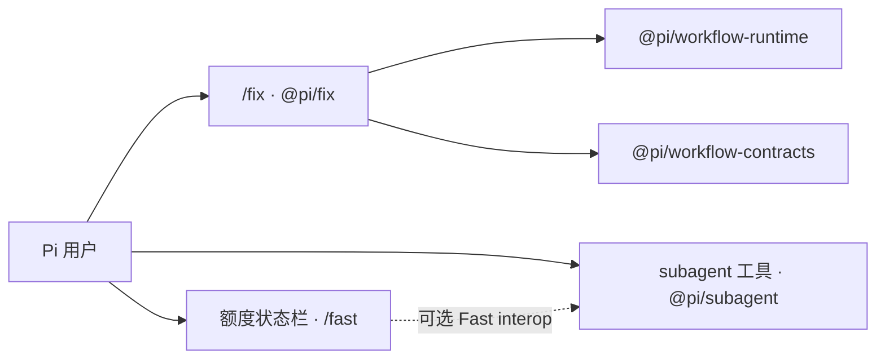

# my-pi-extension

个人 Pi 扩展集合，包含问题处置 Workflow、通用子 Agent 委派、Codex 额度与 Fast 控制、异步压缩本地预览，以及可选的个人 Cloudflare 项目指标。

## 结论先行

| 能力 | 入口 / package | 作用与当前状态 |
| --- | --- | --- |
| 异步压缩预览 | `/async-compact` · `@pi/async-compaction` | 受支持 TUI 中提前生成摘要，自动压缩时有界等待并校验复用；离线 SDK/TUI 已验证，真实 provider 与完整效果未验收。 |
| 问题处置 Workflow | `/fix` · `@pi/fix` | 调查、处置、评审、验证与人工验收；v2 主流程原型已实现。 |
| 通用子 Agent 委派 | `subagent` 工具 · `@pi/subagent` | 隔离委派任务，支持持久 child session、恢复、瞬态重试与模型 fallback；已实现。 |
| Codex 额度与 Fast 控制 | 状态栏、`/fast` · `@pi/codex-usage-status` | 展示 Codex 额度，并控制符合条件请求的 Fast 优先处理；已实现。 |
| 个人项目指标 | `npm run metrics` · `@pi/project-metrics` | Fast 开启次数、后台生成耗时及前台压缩阶段耗时；私有 CF 上报与 CLI 查询已实现，远端采集需显式配置。 |

这四个扩展职责独立：

- `@pi/async-compaction` 在受支持主对话 TUI 中准备候选，默认关闭，原生压缩仍负责提交；普通 CLI 不要求单扩展隔离 profile。
- `/fix` 管理问题处置流程和 Workflow 状态。
- `subagent` 管理通用 child session 的创建、执行、恢复与重试。
- `@pi/codex-usage-status` 管理 Codex 额度与 Fast 请求策略，并通过可选 interop 向 subagent 提供 Fast 信息。

`@pi/subagent` 不是 `/fix` 的另一个名字，也不是当前 `/fix` 的底层实现；它不创建 Workflow Run、Node、Artifact 或 Worker。`/feature` 是规划中的 Workflow 入口，当前尚未实现，也没有对应 package。

已实现不等于完整验证：真实 provider、真实 TUI、长时运行、retry/fallback 和 Fast child E2E 仍有待验证。完整差异见 [L2 当前实现与 drift](docs/02-产品实现/README.md)。

## 能力与边界



| 类别 | 当前能力 | 明确边界 |
| --- | --- | --- |
| `async-compaction` | 完整回复/工具轮预热、原生 threshold 入口等待、校验与提交 | 后台调度仍要求 TUI；未物化输入保留原生路径，真实 provider/终端与效果基线未验收 |
| `/fix` | 以 Workflow 状态、Policy、Artifact、Guard、评审、验证和验收组织问题处置 | 完整治理合同、真实 provider E2E 和长时 TUI 稳定性仍未完成 |
| `subagent` | 独立 child session、持久句柄、恢复、瞬态重试和模型 fallback | 不拥有 Workflow Run/Node/Artifact/Worker 语义；部分 retry/fallback/Fast child E2E 待验证 |
| Codex Usage + Fast | 额度读取与状态展示、`/fast` priority processing、parent-Fast interop | 真实 Pi TUI/provider E2E 与 local dispatcher live E2E 待验证 |
| `/feature` | 产品规划与 L1 规范 | 当前没有可执行 package 或 Workflow Definition |

## Package 目录

| Package | 类型 | 入口 / 职责 | 当前状态 |
| --- | --- | --- | --- |
| `@pi/async-compaction` | Pi extension | `/async-compact`；后台摘要本地预览 | 默认关闭；受支持入口按安全条件采用，尚未完成真实 TUI/性能验收 |
| `@pi/fix` | Pi extension | `/fix`；Fix Workflow 策略、报告、trace 和 Pi UI 接线 | 原型已实现 |
| `@pi/subagent` | Pi extension | `subagent` 工具；通用 child-session dispatcher | 已实现 |
| `@pi/codex-usage-status` | Pi extension | 额度状态栏、`/fast` 与 Fast interop producer | 已实现，真实 provider/TUI E2E 待验证 |
| `@pi/workflow-runtime` | 共享 library | Workflow 状态机、Worker Session、Guard、重试、checkpoint 和恢复 | Pi SDK Runtime 原型已实现；部分 Fix 业务门禁仍待 owner 收敛 |
| `@pi/workflow-contracts` | 共享 library | Stage、Artifact、Checkpoint、Worker 与提交接口合同 | 由 Workflow 入口和 Runtime 使用 |
| `@pi/project-metrics` | Node client + CLI + Worker | 跨扩展的私有待投递、幂等接收与统计查询 | 仅三类项目指标；按配置启用，提供 CLI，不提供业务看板 |
| `@pi/fix-metrics-cloudflare` | 服务端 PoC | 合成 Fix 指标接收、快照、漏斗 API 与页面示例 | 仅合成数据；不是个人项目指标看板，也不是 Pi extension |

### 依赖关系

- `@pi/fix` 依赖 `@pi/workflow-runtime` 与 `@pi/workflow-contracts`。
- `@pi/subagent` 是独立的通用委派扩展，不属于 Workflow Runtime 层级。
- `@pi/codex-usage-status` 独立于 Workflow Runtime；subagent 可选消费它提供的 Fast interop。
- 本机开关的目标是复用 Pi 全局 `settings.json` 的 `myPiExtensions` 字段，读写和运行逻辑归两个既有扩展；当前源码的接线差距见各自 L2。
- Fast 与 Async package 依赖 `@pi/project-metrics` 的 Node client；启用传输不改变两者的宿主兼容范围或加载限制。
- `@pi/fix-metrics-cloudflare` 是独立服务端 PoC，不参与 Pi extension 运行时依赖。

## 开始阅读

按你关心的功能直接进入，文档正文说明当前规则、实现和缺口，不要求先读变更历史或逐层通读。

| 想了解什么 | 阅读入口 |
| --- | --- |
| 异步压缩 | [产品规范](docs/01-产品定义/扩展/async-compaction-扩展.md) · [技术说明](docs/02-产品实现/async-compaction-技术设计.md) |
| Codex 额度与 Fast | [产品规范](docs/01-产品定义/扩展/codex-usage-status-扩展.md) · [技术设计](docs/02-产品实现/codex-usage-status-技术设计.md) |
| 个人 CF 项目指标 | [产品规范](docs/01-产品定义/项目指标.md) · [实现与验证边界](docs/02-产品实现/项目指标-技术设计.md) · [安装和私有配置](docs/03-项目落地/项目配置.md#项目指标本地安装与采集) |
| 通用 Subagent | [产品规范](docs/01-产品定义/扩展/subagent-扩展.md) · [技术设计](docs/02-产品实现/subagent-dispatcher-技术设计.md) |
| Fix 问题处置 | [产品规范](docs/01-产品定义/扩展/fix-扩展.md) · [技术设计](docs/02-产品实现/fix-runtime-technical-design.md) |
| Workflow 共享机制 | [Core 定义](docs/01-产品定义/领域术语.md) · [Runtime 架构](docs/02-产品实现/runtime-实现架构.md) |
| 安装、配置与 package | [仓库组织](docs/03-项目落地/仓库组织.md) · [项目配置](docs/03-项目落地/项目配置.md) |
| 文档归属与更多任务 | [五层职责](docs/README.md) · [文档地图](docs/03-项目落地/文档地图.md) |

Agent 在仓库中工作前必须读取 [AGENTS.md](AGENTS.md)。

## 安装日常扩展

```bash
pi install git:github.com/ZHOUKAILIAN/my-pi-extension@v0.1.0
```

固定版本入口加载 `/fix`、`/fast` 和 `subagent`，不引用本地开发目录；组合加载验证使用 Pi 1.0.4。已有本地安装需先移除重复声明，再 `/reload` 或重启。安装、单入口过滤和回退说明见[项目配置](docs/03-项目落地/项目配置.md#github-固定版本安装)。异步压缩不在日常加载清单内。

## 异步压缩本地预览

可在本仓库根目录用匹配的 Pi 1.0.4 / 1.1.0 单次加载体验；两版已有合成 SDK/TUI 验证，具体范围见 L2：

```bash
pi --no-extensions -e ./packages/async-compaction/src/index.ts
# 首次执行 /async-compact on 保存本机偏好；/async-compact off 持久关闭
```

`--no-extensions` 禁用自动发现，仅保留显式 `-e`，适合隔离体验；这不是源码强制的唯一 profile，正常主 TUI 也可显式加载入口。该启动命令不添加全局 package 声明；`/async-compact on/off` 会保存本机偏好。首次未配置默认 Off，手动压缩仍走原生。等待预算、加载组合及真实 provider/终端的未验证边界由 [L2](docs/02-产品实现/async-compaction-技术设计.md)拥有。

## 本机开关与压缩耗时

已确认的本机配置目标是复用 `~/.pi/agent/settings.json`：`myPiExtensions.fast` 和 `myPiExtensions.asyncCompaction` 分别保存两个开关，不新增偏好目录。所有主/子 Agent 采用同一全局设置，在下一请求、后台调度或候选采用前刷新；另一台电脑独立设置。字段、原生配置保留及权限边界见[项目配置](docs/03-项目落地/项目配置.md#本机功能开关)。字段读写不代表全部主/子入口已生效，实际能力与剩余差距见对应 L2。

正常 Fast 主 TUI 或受支持的 Async 主 TUI 会在实际观察到的原生压缩附近显示“压缩阶段耗时”，包括手动、自动和原生兜底；不依赖功能开关，不改变 token 块。它不是精确用户等待或省时收益，也不会新增 CF 上报。完全无计时诊断的旧历史保留原样，不回填。

## 本地安装与自动采集

先使用包含本功能的仓库版本，在仓库根目录安装 npm workspace 依赖：

```bash
npm ci --ignore-scripts
export PI_METRICS_CONFIG="$HOME/.pi/agent/project-metrics/config.json"
```

本机私有配置中的 `enabled: true` 表示允许远端采集；它还需指定自己的 Worker、namespace、独立读写密钥文件和待投递目录。配置文件与密钥不得进入 Git，JSON 内的文件路径必须是绝对路径。完整模板、私有权限及加载方式见[项目配置](docs/03-项目落地/项目配置.md#项目指标本地安装与采集)。`@pi/project-metrics` 是仓库内 workspace 依赖；本地加载前必须安装整个工作区，不能假设它已发布到 npm。

配置一次并使环境变量对 Pi 进程生效后，加载新版 Fast 或 Async 扩展即可自动上报**实际产生的事件**，不需每次重新打开采集。不额外发送启动事件；Fast/Async 从独立本机偏好恢复，采集配置不会开启功能，也不回填历史。没有配置或 `enabled: false` 时不进行远端采集。

两种扩展使用各自兼容宿主；共用指标库不代表所有加载组合都已验收，实际边界由各自 L2 维护。新增项目指标的本地持久化、待投递与网络在后台调度，不被业务命令或压缩 hook 等待；原有 Session 诊断仍由 Pi 按宿主 API 处理。请求最多五秒，正常退出只给新增本地保存统一一秒预算，不等上传。

在相同工作区和配置环境中查询或补报：

```bash
npm run metrics -- status
npm run metrics -- stats                 # 默认 live 已接收数据
npm run metrics -- stats --validation    # 单独查询隔离验证样本
npm run metrics -- flush                 # 显式补报本配置目标的已保存队列
```

当前没有在线业务看板。业务趋势图需要另行实现前端；CF 自带的请求量、错误率、CPU 或数据库用量图属于运维指标，不会自动成为这里三项业务指标的图表。

## 验证

```bash
npm run test:agent
npm run typecheck
git diff --check
```

`test:agent` 执行与 `npm test` 相同的完整 Node 测试范围；范围由项目管理，执行摘要由 [`node-test-brief`](https://github.com/ZHOUKAILIAN/node-test-brief) 提供。使用方法见[项目配置](docs/03-项目落地/项目配置.md#node-测试摘要)。这些命令不代表真实 provider、长时 TUI 或生产环境 E2E 已通过。

历史选型和评审证据保存在 [docs/归档](docs/归档/README.md)，但不属于当前执行规则或正式真理源。
