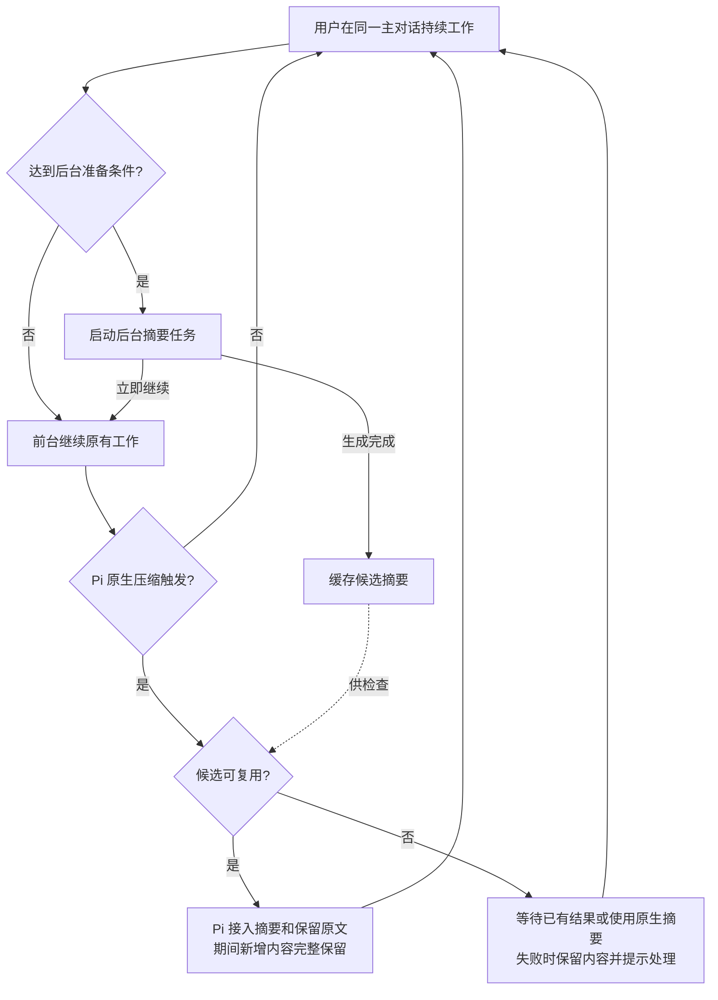

# Async Compaction Extension 产品规范

**用户目标：把上下文摘要的生成提前到后台，尽量减少压缩对当前工作的打断，同时保留期间新增内容和任务连续性。**

| 项目 | 定义 |
| --- | --- |
| 状态 | `DECIDED`；方案 A 已采纳用于主对话本地预览，效果与推广门槛见 §7 |
| 产品边界 | 独立的 Pi 会话上下文管理能力 |
| 核心行为 | 提前准备摘要且前台继续 → Pi 原生压缩触发时校验复用 → 无合格结果时走原生摘要 |
| 实现情况 | 见 [L2 技术说明](../../02-产品实现/async-compaction-技术设计.md) |

## 1. 用户主路径

摘要先缓存，Pi 触发原生压缩时再复用。

举例：后台处理旧历史 H，期间新增要求、回复和工具结果组成 N。接入后的上下文为“覆盖 H 的摘要及需保留的原文 + N”。

## 2. 启用、适用范围与用户控制

1. 每个主对话实例默认关闭；通过 §5 的命令启用，new/resume/fork/reload 后重新关闭，不持久化开关。关闭时回到宿主原有压缩行为，保留已提交的历史和摘要。
2. 首版只在主对话启用异步压缩；Subagent child 沿用自身原有的压缩路径。
3. 后台准备阶段不因摘要尚未完成而主动暂停前台工作；原有模型、工具、输入排队和取消规则继续生效。接受输入不等于模型已经消费输入。
4. 更新上下文不创建新会话，不更改用户正在处理的任务，不自动切到其他分支；历史仍可按宿主原有能力追溯。
5. 用户关闭能力、停止当前运行或离开当前会话时，取消后台任务；未采用结果不能继续接入或影响其他会话。
6. 当前宿主、模型或组合不受支持时，明确说明并保持原生路径。
7. 宿主关闭自动压缩时不启动后台预生成，手动 `/compact` 沿用原生路径。

## 3. 何时提前准备，何时必须等待

| 概念 | 含义 |
| --- | --- |
| 软阈值 | 提前启动后台压缩，给后续内容留出空间 |
| 硬限制 | 包含必要预留的保护边界；到达后先处理上下文，再继续请求 |
| 安全接入时机 | Pi 触发原生压缩时，由宿主在后续模型请求前更新上下文 |
| 可采用结果 | 与当前历史匹配、覆盖范围明确、保留内容完整，接入后能释放足够空间 |

- 未到硬限制时继续工作；到达后等待可用结果或前台压缩。
- 生成失败、结果失效或空间不足时保留原内容，继续处理上下文；无法估算预算时记为未知。
- 限制重复启动、频率、并发和用量，避免反复重算；工程参数见 L2。

## 4. 连续性与正确性保证

| 用户需要的保证 | 候选要求 |
| --- | --- |
| 补充要求不丢 | 后台期间新增的用户输入、可见模型回复和工具结果不能因旧结果接入而遗漏、乱序或被旧状态覆盖 |
| 保留范围准确 | 被移出原文的历史必须处于摘要实际覆盖范围；尚未覆盖的内容需保留或另外处理 |
| 工具执行不重放 | 不能因重新组织上下文重复执行读写文件、命令或其他外部操作；保留工具调用与结果的合法关联 |
| 任务状态不回退 | 摘要应保留目标、有效约束、关键决定、已完成事项、未完成事项和证据线索；不能把“尚待验证”写成“已完成” |
| 旧结果不污染新历史 | 换分支、修改既有上下文或其他影响适用性的变化后，先重新确认结果有效性；无法确认则不采用 |
| 历史仍可追溯 | 压缩减少模型当前输入，不以删除原始会话历史换取速度；已采用结果应遵循宿主会话恢复语义 |
| 摘要质量可验证 | 通过代表性任务验证约束、事实和最新要求的连续性 |

能力基于普通模型调用生成文本摘要，不依赖特定厂商的原生压缩协议。兼容厂商和型号以实际验证范围为准。

## 5. 交互、费用与隐私

### 5.1 启停命令

命令只提供两种操作，各反馈一次操作结果：

| 命令 | 行为 |
| --- | --- |
| `/async-compact on` | 开启当前主对话的异步压缩；达到触发条件后才启动后台任务 |
| `/async-compact off` | 关闭当前主对话的异步压缩，停止新增后台任务，未采用结果不再接入 |

### 5.2 按需过程提示

- 不设置底部常驻标识。没有压缩任务时，正常对话不显示本能力的状态。
- 后台压缩执行时，在当前主对话中显示 `async-compact` 过程提示；本次生成结束后收起提示。
- 实际需要等待后台结果或执行前台压缩时，过程提示说明正在等待或前台兜底；需要用户处理的失败在当前对话中反馈。
- 摘要生成完成与上下文接入分别处理；只有接入成功才能反馈“上下文已更新”。

### 5.3 费用与隐私

- 后台请求消耗模型额度，并可能争用前台限流和并发资源。展示已采用、未采用及失败调用的已知开销；用量缺失标为未知。
- 已采用调用只计一次；宿主总账未覆盖的额外开销单独标明。
- 摘要使用当前实际聊天模型、provider 和 thinking；不独立选模、不跨厂商发送、不自动 fallback。
- 摘要不扩大工具、文件或网络权限；不修改其他功能的业务状态或授权。
- 不新增默认远端 telemetry，不向日志或公开详情输出凭证、完整会话原文或原始 provider 响应。候选存储与保留策略由 L2 明确，不默认额外复制敏感历史。

### 5.4 本地阶段耗时

本地预览提供两项单次阶段耗时，不将阶段耗时解释为实际用户等待或相对原生策略的省时收益：

| 指标 | 区间与总体 |
| --- | --- |
| 后台生成耗时 | 每个已发起的后台摘要操作，从调用 SDK 开始到结果实际结算；不包含快照准备及生成完成后等待采用的时间 |
| 前台压缩阶段耗时 | 开始时已启用且受支持的主对话 threshold 机会，从本扩展压缩处理 hook 进入到宿主提交成功或失败；包含候选等待及原生兜底，不含 hook 前的准备、终态后的任务恢复；manual、overflow 和未启用机会不计入 |

- 两个总体分别记录、按单调时钟计算。关闭、取消或超时请求不等于后台操作已结束；已开始的前台阶段也不因关闭开关提前结算。
- 生成结果完成、失败和中止分别标识，迟到成功表示生成完成而非采用成功。缺少可观察终态、时钟无效或离开作用域时，耗时标为未知，不补零；已结束样本只记录一次。
- 记录与展示仅在本地会话中进行，不进入模型上下文、不新增远端上报。持久会话随宿主 Session 保存；`--no-session` 不保留退出后的记录。重新打开会话不从诊断记录恢复开关。
- 记录或展示失败不改变压缩结果、取消、费用或原生路径。若模型调用观察接口故障而无法确认请求终结，停止当前作用域的后台重试，明确提示原生压缩仍可用及恢复方式。

阶段耗时的实现与统计可用范围见 L2；§7 的完整效果验收口径独立保留。

## 6. 验收标准

| 编号 | 场景 | 通过条件 |
| --- | --- | --- |
| A1 | 未启用、宿主自动压缩关闭、不支持或 Subagent child | 不新增本能力的后台摘要请求，保持宿主原有压缩路径 |
| A2 | 达到软阈值但仍有余量 | 可以后台准备，前台继续执行，不因等待摘要而主动停顿 |
| A3 | 生成期间有新增输入和工具活动 | 接入后完整保留其顺序与有效内容，无旧快照覆盖增量，无重复外部操作 |
| A4 | Pi 原生压缩触发且候选可复用 | 由 Pi 接入候选；只有接入成功才反馈上下文已更新，不更换会话身份 |
| A5 | 旧历史、分支或相关环境变化 | 无法确认适用性时不采用旧结果，不污染其他历史 |
| A6 | 硬限制已到，候选未完成或无效 | 明确等待、前台兜底或失败提示；不无界等待、不静默丢上下文、不盲目越过保护边界 |
| A7 | 摘要接入后回收不足 | 不宣称压缩已解决压力；继续受控处理，避免无收益的重复压缩循环 |
| A8 | timeout、限流、截断、空摘要或服务失败 | 无不完整结果被接入；原内容仍保留，额外工作有终态且重试受限 |
| A9 | 关闭、停止运行、离开会话、reload 或退出 | 取消后台任务，旧结果不再接入；新会话实例默认关闭，已知用量仍可核对 |
| A10 | 已采用、丢弃和失败请求的用量 | 已知开销不漏报、不重复；未知开销明确标识；新增调用有约束 |
| A11 | 恢复会话及连续多次压缩 | 已提交上下文可按宿主规则恢复，关键事实和最新任务状态不因连续压缩无依据回退 |
| A12 | 体验验证 | 按 §7 的完整总体统计命中、等待和额外开销，并核对固定事实保留与总任务耗时 |
| A13 | 命令与过程提示 | `on` / `off` 启停当前主对话并各反馈一次；无底部常驻标识，压缩执行时显示 `async-compact`，生成结束后收起；实际等待、兜底和需用户处理的失败有对应反馈 |
| A14 | 本地阶段耗时 | 按 §5.4 分别记录后台生成和前台压缩阶段；覆盖命中、等待、miss/原生兜底与 input preflight 旁路，终态去重、未知不补零、关闭不提前结算、跨作用域不误写；记录故障不影响原生压缩 |

## 7. 本地预览的效果口径

| 指标 | 口径 |
| --- | --- |
| 自动压缩总体 | 观察窗口内，已启用且受支持的主对话发生的全部 threshold 原生压缩机会；包括 miss、失效、失败、取消和原生兜底 |
| 复用率 | 实际提交匹配候选的机会数 / 自动压缩总体；以实验 session 和原生压缩序号去重 |
| 前台压缩等待 | 原生压缩开始至后续任务推理请求恢复或明确失败/取消的区间，排除摘要请求，包含候选等待与原生兜底；没有后续请求的样本单列 |
| 其他触发原因 | manual、overflow 分层报告，不混入 threshold 复用率；原生未启用基线单独对照 |
| 后台开销 | 按 attempt 统计采用、丢弃、失败和取消的已知 usage，unknown 单列；同一调用只计一次 |
| 任务效果 | 固定合成任务同时比较总耗时、总 tokens 和事实/约束保留，保留完整样本而非只选命中案例 |

数据仅用于本地预览。阈值、冷却和等待等工程参数见 L2；是否推广以及可接受的额外额度、等待和质量门槛，依据基线结果确认。
