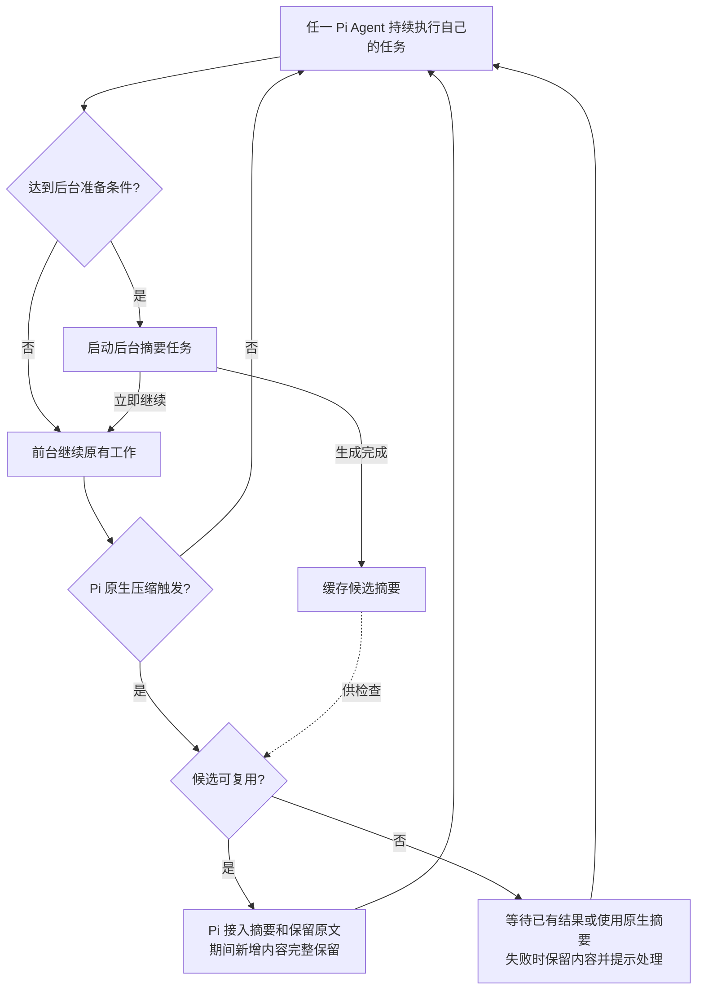

# Async Compaction Extension 产品规范

**用户目标：把上下文摘要的生成提前到后台，尽量减少压缩对当前工作的打断，同时保留期间新增内容和任务连续性。**

| 项目 | 定义 |
| --- | --- |
| 状态 | `DECIDED`；全部 Pi Agent、本机开关、失败降级、日常联用与子 Agent 阶段采集为已采纳契约；当前实现见 L2 |
| 产品边界 | 由既有 Async Compaction 扩展提供，面向本机当前用户的全部 Pi Agent；不新增独立状态扩展或额外控制入口 |
| 核心行为 | 提前准备摘要且前台继续 → Pi 原生压缩触发时校验复用 → 无合格结果时走原生摘要 |
| 实现情况 | 见 [L2 技术说明](../../02-产品实现/async-compaction-技术设计.md) |

## 1. 用户主路径

摘要先缓存，Pi 触发原生压缩时再复用。

举例：后台处理旧历史 H，期间新增要求、回复和工具结果组成 N。接入后的上下文为“覆盖 H 的摘要及需保留的原文 + N”。

## 2. 启用、适用范围与用户控制

1. 异步压缩是本机当前用户的统一开关，状态持久保存在本地，不属于会话、Agent、模型登录账号或 CF。首次未配置默认关闭；开启与关闭均跨 new/resume/fork/reload、进程重启沿用，不必逐对话开启。另一台电脑独立配置，不自动同步；该开关与 Fast 开关互相独立。
2. 本机开启后，全部 Pi 主 Agent、子 Agent 均采用该开关，包括单个、并行、顺序委派及新建、继续、重试的 Agent。角色名称、user/project 来源、TUI/RPC/JSON/print 和有无 UI 均不是默认排除条件；不要求逐个子 Agent 声明继承或手动 on。
3. 后台准备阶段不因摘要尚未完成而主动暂停前台工作；原有模型、工具、输入排队和取消规则继续生效。接受输入不等于模型已经消费输入。
4. 更新上下文不创建新会话，不更改用户正在处理的任务，不自动切到其他分支；历史仍可按宿主原有能力追溯。
5. 用户关闭本机能力后，所有 Agent 都应停止新增后台准备和候选采用；停止某个 Agent 或离开其会话仅取消该 Agent 的旧任务，不关闭本机开关，也不取消其他 Agent 的工作。未采用结果不能跨 Agent 或会话接入。导航取消不得永久关闭能力；reload 失败不保证旧实例继续运行，但不把持久偏好写 Off。
6. 每个 Agent 仍核验自身实际宿主、模型、自动压缩设置和可安全接入的条件；不支持时明确说明并保留原生路径，不把“配置 On”说成“已生效”。现有隔离入口、版本及模式限制由 L2 记录为实现差距，不能用来把产品目标收窄为仅主 TUI。
7. 宿主关闭自动压缩时不启动后台预生成，手动 `/compact` 沿用原生路径。所有 Agent 只共享开关，各自保有独立历史、候选、取消边界和用量；不得跨 Agent 复用私有原文或摘要。

## 3. 何时提前准备，何时必须等待

| 概念 | 含义 |
| --- | --- |
| 软阈值 | 提前启动后台压缩，给后续内容留出空间 |
| 硬限制 | 包含必要预留的保护边界；到达后先处理上下文，再继续请求 |
| 安全接入时机 | Pi 触发原生压缩时，由宿主在后续模型请求前更新上下文 |
| 可采用结果 | 与当前历史匹配、覆盖范围明确、保留内容完整，接入后能释放足够空间 |

- 在完整回复结束，或本轮全部工具调用与成功结果已经落入历史后，检查后台准备条件；持续工具执行不必等到最终回答才有准备机会。任一工具结果存在业务错误，即使调用和结果完整，也不触发预热；不完整或中止的工具轮同样不作为新增准备入口。
- 未到硬限制时继续工作，不等待后台摘要。到达受支持的自动压缩入口时，已完成且合格的候选直接复用；合格候选仍在生成时，等待同一个任务的剩余生成预算，不另起一份摘要请求。
- 生成预算从后台调用开始计算，不在进入前台等待时重置。没有候选、候选不合格、失败、失效或预算到期时保留原生路径；无法确认新输入、保留内容或预算安全的入口也保留原生路径。原生准备输入若在等待或后续处理期间过期，须安全取消本次压缩或重新准备，不能使用过期输入兜底。后台预算不是包含原生兜底在内的总完成时限。
- 本扩展参与的受支持自动压缩以准备历史的有效性优先，无可用候选时也保留最终安全校验。宿主按扩展顺序选用处理结果时，允许该安全处理覆盖更早扩展的候选，可能增加原生摘要的耗时与用量；不承诺透明保留所有扩展结果。后置扩展覆盖本扩展处理结果的组合须单独验证，不把安全保证扩大到任意组合。
- 用户停止或宿主取消时及时结束等待，不以自动启动原生摘要抵消取消；关闭异步能力禁止继续等待或采用旧候选，但不关闭宿主原生压缩。请求取消不等于物理调用已经结算，迟到结果不得恢复采用资格。
- 生成失败、结果失效或空间不足时保留原内容，继续受控处理上下文；无法估算预算时记为未知。
- 限制重复启动、频率、并发和用量，避免反复重算；工程参数见 L2。

## 4. 连续性与正确性保证

| 用户需要的保证 | 候选要求 |
| --- | --- |
| 补充要求不丢 | 后台期间新增的用户输入、可见模型回复和工具结果不能因旧结果接入而遗漏、乱序或被旧状态覆盖 |
| 保留范围准确 | 被移出原文的历史必须处于摘要实际覆盖范围；尚未覆盖的内容需保留或另外处理 |
| 工具执行不重放 | 不能因重新组织上下文重复执行读写文件、命令或其他外部操作；保留工具调用与结果的合法关联 |
| 任务状态不回退 | 摘要应保留目标、有效约束、关键决定、已完成事项、未完成事项和证据线索；不能把“尚待验证”写成“已完成” |
| 旧结果不污染新历史 | 换分支、修改既有上下文或其他影响适用性的变化后，先重新确认结果有效性；无法确认则不采用 |
| 历史仍可追溯 | 压缩减少模型当前输入，不以删除原始会话历史换取速度；已采用结果应遵循宿主会话恢复语义 |
| 摘要质量可验证 | 通过代表性任务验证约束、事实和最新要求的连续性 |

能力基于普通模型调用生成文本摘要，不依赖特定厂商的原生压缩协议。兼容厂商和型号以实际验证范围为准。

## 5. 交互、费用与隐私

### 5.1 启停命令

命令只提供两种操作，各反馈一次操作结果：

| 命令 | 行为 |
| --- | --- |
| `/async-compact on` | 保存本机开启设置，所有 Pi 主/子 Agent 均采用；各自达到准备条件后才发起后台任务 |
| `/async-compact off` | 保存本机关闭设置，所有 Pi Agent 停止新增后台任务与候选采用，回到原生压缩路径 |

本机偏好、每个 Agent 的实际生效条件和后台任务状态分开。无 UI 不是拒绝读取本机开关的理由；普通 Agent 执行不能自行修改用户开关。某个 Agent 的模型或宿主自动压缩暂不支持时，保留本机 On、明确其当前不运行；条件恢复后不要求用户重复开启。模型切换也不得把本机 Off 自动打开。

本机开关复用 Pi 用户级全局设置；命令与用户直接编辑配置修改同一值，项目配置不覆盖它。已运行 Agent 在下一模型请求、后台压缩调度或候选采用前刷新适用设置，不等待再次输入或重启。任何来源的已接受 On→Off 都禁止新调度和采用、取消旧任务；已发出的物理请求只尽力取消，迟到结果结算已发生用量但不复活候选。

操作反馈必须区分本机设置是否可靠保存、当前 Agent 是否实际生效；保存失败不能把临时或局部行为说成全机更新成功。开关不从诊断记录恢复，不进入模型上下文，也不代替远端采集许可。

### 5.2 按需过程提示

- 不设置底部常驻标识。没有压缩任务时，正常对话不显示本能力的状态。
- 后台压缩执行时，在实际执行该任务的 Agent 所属可见入口显示 `async-compact` 过程提示；本次生成结束后收起。无 UI 的执行仍可采用本机设置，不要求伪造 TUI 或把所有子 Agent 的过程刷入主对话。
- 实际需要等待后台结果或执行前台压缩时，过程提示说明正在等待或前台兜底；需要用户处理的失败在当前对话中反馈。
- 摘要生成完成与上下文接入分别处理；只有宿主实际提交了本次匹配候选，才能反馈“上下文已更新”。摘要文本相同不等于同一个任务被采用。
- 进入准备检查但未启动的判断保留有界、结构化的本地原因，区分开关、入口、预算未知、队列、任务占用、冷却及安全快照等门禁。低压力重复检查不能耗尽后续高压力原因的记录机会，容量限制须明确标识。记录不包含对话原文、凭证或原始服务响应，不进入模型上下文，不新增远端采集或空闲可见状态；诊断失败不得改变调度、取消和原生路径。

### 5.3 费用与隐私

- 后台请求消耗模型额度，并可能争用前台限流和并发资源；多个 Agent 的后台请求可能叠加消耗。各 Agent 的已采用、未采用及失败调用分别核对已知开销，用量缺失标为未知；共享开关不等于共享费用或全机只有一个后台请求。
- 已采用调用只计一次；宿主总账未覆盖的额外开销单独标明。
- 摘要使用当前实际聊天模型、provider 和 thinking；不独立选模、不跨厂商发送、不自动 fallback。
- 摘要不扩大工具、文件或网络权限；不修改其他功能的业务状态或授权。
- 不新增默认远端 telemetry，不向日志或公开详情输出凭证、完整会话原文或原始 provider 响应。候选存储与保留策略由 L2 明确，不默认额外复制敏感历史。

### 5.4 本地阶段耗时

本地预览提供两项单次阶段耗时，不将阶段耗时解释为实际用户等待或相对原生策略的省时收益：

| 指标 | 区间与总体 |
| --- | --- |
| 后台生成耗时 | 每个已发起的后台摘要操作，从调用 SDK 开始到结果实际结算；不包含快照准备及生成完成后等待采用的时间 |
| 前台压缩阶段耗时 | 开始时已启用且受支持的各 Pi Agent 的 threshold 机会，从本扩展压缩处理 hook 进入到宿主提交成功或失败；包含候选等待及原生兜底，不含 hook 前的准备、终态后的任务恢复；manual、overflow 和未启用机会不计入 |

- 两个总体分别记录、按单调时钟计算。关闭、取消或超时请求不等于后台操作已结束；已开始的前台阶段也不因关闭开关提前结算。
- 生成结果完成、失败和中止分别标识，迟到成功表示生成完成而非采用成功。缺少可观察终态、时钟无效或离开作用域时，耗时标为未知，不补零；已结束样本只记录一次。
- 本地记录与展示不进入模型上下文。远端项目指标仅在用户显式配置采集后按[个人项目指标](../项目指标.md)合同发送；默认关闭，不回填历史。持久会话随宿主 Session 保存；`--no-session` 不保留退出后的记录。重新打开会话不从诊断记录恢复开关。
- 记录或展示失败不改变压缩结果、取消、费用或原生路径。若模型调用观察接口故障而无法确认请求终结，停止当前作用域的后台重试，明确提示原生压缩仍可用及恢复方式。

全部 Agent 的本地展示按 §5.5 定义。显式启用项目采集后，主/子 Agent 的后台生成及受支持 threshold 前台阶段均可上报，事件注明有限的 Agent 类型；采集许可、来源区分与历史兼容由[个人项目指标](../项目指标.md)拥有。§7 的效果验收独立保留。

### 5.5 通用压缩阶段耗时展示

本扩展拥有压缩耗时的产品展示：凡向用户呈现 `[compaction]` token 信息的入口，须同时呈现该次压缩阶段耗时，可在附近新增一行；不修改原有摘要或展开语义，不要求 Fast 扩展承担压缩展示职责。

- 覆盖主 Agent、子 Agent 的 manual、threshold、overflow，包括异步命中、等待、原生兜底及异步开关关闭的情况；有无 UI 不影响本地计时。无 UI 的 Agent 保留可供其结果/历史入口查询的本地记录，不强制把子 Agent 过程刷入主对话。
- 计时区间为本扩展观察到压缩 hook 入口至匹配的宿主成功/失败 hook 入口，使用单调时钟，标为“压缩阶段耗时”。不包含 hook 前准备、后台预生成或压缩后的任务恢复，不声称是精确用户等待或省时收益。
- 每次开始与终态唯一配对，以当前活动分支的新压缩记录关联；不能只凭摘要文本或宿主事件的旧记录指针判断。重复终态不重复记录，跨分支/会话旧结果不能贴到新压缩。
- 成功显示耗时，失败/取消有真实观测时标明终态；已有诊断损坏、时钟无效或关联失效时显示“未知”，不填零。没有对应开始的终态不伪造样本；完全无计时诊断的旧历史只保留原生 token 块，不回填。
- 诊断不进入模型上下文、不增加模型调用、不发送项目指标；§5.4 的后台及 threshold 前台计时与远端总体独立保留。记录、渲染和恢复故障不得改变原生压缩结果、取消、费用或业务执行。
- 已有诊断可随 Session 恢复，重复打开不补写记录；`--no-session` 仅当前进程保留。

### 5.6 失败、联用与采集

- 读取全局配置失败或字段无效时，停止新增后台生成和旧候选采用，回到原生路径；保存失败不冒称全机变更、不改写已保存真值。两种故障均不阻断原来的模型/压缩工作；提示不泄露配置原文，迟到任务仍按已发生用量结算。
- Fast 与异步压缩在同一个正常 Pi 入口共同使用，不要求用户为子 Agent 再开一次，也不要求专用隔离会话。入口不支持时明确实际能力与原生兜底，不能仅删 guard 宣称接线完成。
- 主/子 Agent 的阶段样本在既有显式采集许可下均可上报，子 Agent 明确标为 subagent；不添加任务、角色名或会话内容，不从旧记录回填。

## 6. 验收标准

| 编号 | 场景 | 通过条件 |
| --- | --- | --- |
| A1 | 未启用、宿主自动压缩关闭或当前模型/宿主不支持 | 不新增本能力的后台摘要请求，保持宿主原有压缩路径；不能仅因它是子 Agent 或没有 UI 就排除 |
| A2 | 达到软阈值但仍有余量 | 完整回复及已持久化、全部结果成功的完整工具轮均可检查后台准备；任一工具业务失败、不完整或中止轮不触发预热；前台不因等待摘要而主动停顿，未启动时可通过安全的本地诊断区分门禁 |
| A3 | 生成期间有新增输入和工具活动 | 接入后完整保留其顺序与有效内容，无旧快照覆盖增量，无重复外部操作 |
| A4 | Pi 原生压缩触发且候选可复用 | 由 Pi 接入候选；只有接入成功才反馈上下文已更新，不更换会话身份 |
| A5 | 旧历史、分支或相关环境变化 | 无法确认适用性时不采用旧结果；原生准备输入过期时安全取消或重新准备，不以过期原生兜底污染当前有效历史 |
| A6 | 硬限制已到，候选未完成或无效 | 合格在途候选使用同一次生成的剩余预算等待；无候选、失效或到期时原生兜底；用户取消不自动兜底。提示与真实阶段一致，不无界等待、不静默丢上下文、不盲目越过保护边界 |
| A7 | 摘要接入后回收不足 | 不宣称压缩已解决压力；继续受控处理，避免无收益的重复压缩循环 |
| A8 | timeout、限流、截断、空摘要或服务失败 | 无不完整结果被接入；原内容仍保留，额外工作有终态且重试受限 |
| A9 | 关闭、停止运行、离开会话、reload 或退出 | 取消旧作用域后台任务，旧结果不再接入；新实例读取本机偏好，取消导航不失效，reload 失败不改持久偏好，已知用量按安全归属核对 |
| A10 | 已采用、丢弃和失败请求的用量 | 已知开销不漏报、不重复；未知开销明确标识；新增调用有约束 |
| A11 | 恢复会话及连续多次压缩 | 已提交上下文可按宿主规则恢复，关键事实和最新任务状态不因连续压缩无依据回退 |
| A12 | 体验验证 | 按 §7 的完整总体统计命中、等待和额外开销，并核对固定事实保留与总任务耗时 |
| A13 | 命令与过程提示 | on/off 设置本机统一偏好并反馈保存与生效结果；可见执行入口按需显示过程，无 UI 不阻止执行；不新增独立状态扩展、常驻底栏或额外控制入口 |
| A14 | 本地阶段耗时 | 按 §5.4 分别记录后台生成和前台压缩阶段；覆盖命中、等待、miss/原生兜底与 input preflight 旁路，终态去重、未知不补零、关闭不提前结算、跨作用域不误写；记录故障不影响原生压缩 |
| A15 | 本机持久偏好 | 开启与关闭跨会话、重启恢复，主/子 Agent 共用；不存 Session/CF、不按模型账号归属、不自动同步其他电脑；读取失败或保存失败不伪称全机生效 |
| A16 | 通用压缩耗时 | 主/子 Agent 的 manual/threshold/overflow 及能力 Off 时均有本地观察；可见 compaction 块附对应耗时；失败/取消/未知明确，跨 scope 不误贴，旧历史不回填，不因展示自动上报 |
| A17 | 全部 Agent 与隔离 | 单个/并行/顺序、新建/继续/重试及 user/project 来源均采用本机开关；各自历史、候选、用量独立；结束一个 Agent 不关闭全机偏好或取消其他 Agent |

## 7. 本地预览的效果口径

| 指标 | 口径 |
| --- | --- |
| 自动压缩总体 | 效果实验窗口内，已启用且受支持的各 Pi Agent 的全部 threshold 原生压缩机会；主/子 Agent 分层，包括 miss、失效、失败、取消和原生兜底；该实验总体不自动成为远端采集授权 |
| 复用率 | 实际提交匹配候选的机会数 / 自动压缩总体；以实验 session 和原生压缩序号去重 |
| 前台压缩等待 | 原生压缩开始至后续任务推理请求恢复或明确失败/取消的区间，排除摘要请求，包含候选等待与原生兜底；没有后续请求的样本单列 |
| 其他触发原因 | manual、overflow 分层报告，不混入 threshold 复用率；原生未启用基线单独对照 |
| 后台开销 | 按 attempt 统计采用、丢弃、失败和取消的已知 usage，unknown 单列；同一调用只计一次 |
| 任务效果 | 固定合成任务同时比较总耗时、总 tokens 和事实/约束保留，保留完整样本而非只选命中案例 |

数据仅用于本地预览。阈值、冷却和等待等工程参数见 L2；是否推广以及可接受的额外额度、等待和质量门槛，依据基线结果确认。
