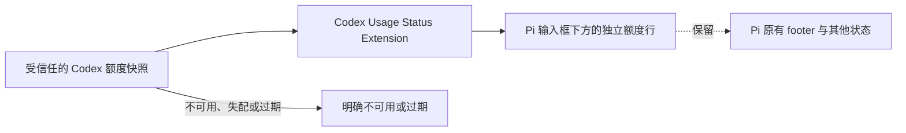

# Codex Usage Status + Fast Extension 产品规范

| 项目 | 定义 |
| --- | --- |
| 状态 | `DECIDED`；本机统一开关、全部 Pi Agent、失败降级和日常联用为已采纳契约；当前实现与差距见 [L2 技术说明](../../02-产品实现/codex-usage-status-技术设计.md) |
| 用户目标 | 查看 Codex 订阅额度，并通过一次本机设置统一控制所有 Pi 主 Agent、子 Agent 的 Fast 请求意图；不必逐会话或逐角色开启。 |
| 关键保证 | 额度只表示默认 bucket；Fast 表示 priority 请求意图，不保证加速；模型资格与费用修正分别判断；敏感授权不展示、不持久化。 |

## 1. 产品保证

扩展必须：

1. 只展示默认 Codex 主额度 bucket 的有效窗口；完全忽略 `additional_rate_limits`（例如 `GPT-5.3-Codex-Spark`）。不展示 `default` 标签。采用 C「胶囊额度」样式，正常格式为 `Codex · 98% ██████████ · Sep 16 10:41`；不把窗口名称或时长硬编码为“5 小时”或“每周”。
2. 进度条表达**剩余比例**，由 10 个固定单元组成：填充数为 `round(remainingPercent / 10)`，已填充为 `█`、未填充为 `░`。正常状态的比例和已填充条固定为 truecolor `#74d9a5`，未填充网格固定为 faint `#59677c`；每段 ANSI 必须立即 reset。`Codex` 和重置时间保持 Pi `dim`；`stale`/`status unknown` 为 Pi `warning`、`limit reached` 为 Pi `error`。许可状态和比例必须排在重置详情之前；额度行的组件通过 `render(width)` 使用 ANSI-safe `truncateToWidth` 截断，始终至多一行。
3. 明确区分“窗口剩余比例”与“当前允许使用”：默认 bucket 的 `allowed` 为 false 时显示 `Codex limit reached`；其缺失时显示 `Codex status unknown`，不得仅因 `NN% left` 推断仍能使用。
4. 区分当前快照、过期快照和不可用。刷新失败后，最近成功且账户作用域仍匹配的快照仅在 `now - fetchedAt < 10 分钟` 时显示 `stale`；到达 `now - fetchedAt >= 10 分钟` 时必须清除旧比例并显示 `Codex: unavailable`，即使没有新请求结果。
5. 仅向固定的 `https://chatgpt.com/backend-api/wham/usage` 发起额度请求，且禁止重定向；不得因 provider base URL 覆盖、代理或 Location 跳转向其他 origin 发送授权或账户作用域。
6. 不展示、记录或持久化 bearer token、账户标识、完整响应体、请求头或响应头。
7. 额度查询失败、超时、字段不兼容或扩展被禁用时，不得阻塞、取消、重试或改变 Pi 的模型请求和会话状态。
8. 同 provider 登录、登出或切换账号没有 Pi 认证事件时，扩展按每次输入、模型切换和最多 60 秒的授权校验识别作用域变化。每次成功确认作用域后开始 60 秒 lease；lease 到期即先清除快照并显示 `unavailable`，再后台校验，因此旧作用域快照最多继续展示 60 秒；新身份及额度的确认仍取决于后台校验完成，不保证 60 秒内成功。发现变化时必须立即清除旧快照。
9. 额度行使用 Pi `setWidget('codex-usage-status', factory, { placement: 'belowEditor' })`；不调用 `setFooter`，不以换行符模拟布局。Codex 会话中同一行由 Fast 在左、额度在右，固定顺序为 `<Fast 状态> · <Codex 额度>`，例如 `⚡ Fast · Codex · 98% ██████████ · Sep 16 10:41`；Fast off/inactive 也显示在左侧。Pi 默认 footer 和其他扩展状态保持共存，Fast 不以独立 `codex-fast` footer status 重复显示。
10. 每次合并行展示前先以 `setStatus('codex-usage-status', undefined)` 与 `setStatus('codex-fast', undefined)` 清除历史 status；隐藏、模型切换、非 TUI、关闭和 shutdown 清除合并 widget 与两个旧 status，不能留下重复文本或空占位。

## 2. Fast 交互、请求与计费保证

### 2.1 请求意图、状态与模型 eligibility

1. Fast 是本机当前用户的统一开关，状态持久保存在本地，不属于某个会话、Agent、模型登录账号或 CF。首次未配置默认 Off；开启与关闭均跨 new/resume/fork/reload、进程重启沿用。另一台电脑独立配置，不自动同步；Fast 与异步压缩是两个独立开关。
2. 只提供 `/fast`（无参数切换本机开关）、`/fast on` 和 `/fast off`。显式 `toggle`、`status`、多参数及未知参数只提示 `/fast [on|off]`，不改变开关。状态通过既有额度行和操作反馈展示，不新增查询命令。用户可通过 TUI/RPC 的显式控制入口设置；JSON、print 或无 UI 不妨碍 Agent 读取并采用本机状态，普通 Agent 执行不能自行改写用户开关。一次操作的目标是本机全部 Pi Agent，不是只改变发出命令的会话。
3. 区分本机 requested intent 和当前请求 effective state：Off、On 且 eligible 时 Active、On 且不 eligible 时 Inactive。模型切换不清除本机 On；切回 eligible 后按同一本机状态生效。额度 limited、stale 或 unavailable 不得自动关闭 Fast；不支持的模型/provider 必须明确为未生效，不能假称已获得 priority。
4. Fast 的 eligibility 必须同时满足：
   - provider 恰为 `openai-codex`；
   - API 恰为 `openai-codex-responses`；
   - base URL 恰为 `https://chatgpt.com/backend-api`；
   - `ctx.modelRegistry.isUsingOAuth(ctx.model)` 为真；
   - model id 以精确小写 `gpt-` 前缀开头，且前缀之后的 suffix 非空并且不含任何空白字符。

   因此 `gpt-5.4`、`gpt-5.4-mini`、`gpt-5.4-spark`、`gpt-5.4-astra` 以及未来满足该形状的型号 eligible；`gpt-`、`GPT-5.4`、含空白 suffix 的型号、非 GPT 型号、第三方 provider 或任何 gate 失配均不 eligible。该判定不读取额度授权、不联网、不启动 timer。

   已知计费型号集合仅用于费用修正，不是 Fast eligibility 白名单；资格由上述精确 `gpt-` 形状和官方 Codex gate 独立判定。公共导出名称及当前兼容代码由 L2 说明。
5. Active 时，仅对 plain-object provider payload 且 `payload.model` 精确匹配当前模型 id 的 `before_provider_request` 请求返回浅复制并设置 `service_tier: "priority"`；其他情况保持不变。Fast 只作用于实际触发该 hook 的逻辑 Agent 请求；该返回值是本扩展的请求输出，不是“请求实际已按 priority 发送”的证明。
6. 在 Codex 额度行左侧显示 `⚡ Fast`（受限 truecolor soft-orange `#D98C3F`，RGB `(217, 140, 63)`，固定 ANSI 序列 `\u001b[38;2;217;140;63m⚡ Fast\u001b[0m`，文本后立即 reset）、Fast inactive（muted）或 Fast off（muted）；不写独立 `codex-fast` footer status。
7. Active 和模型切换通知必须区分 cost policy：
   - 已知型号 `gpt-5.4`、`gpt-5.5`、`gpt-5.6-luna`、`gpt-5.6-sol`、`gpt-5.6-terra` 使用 Fast enabled 与本机全部 Pi Agent 共用开关的提示，费用规则见下文；
   - 其他符合 eligibility 的未知 `gpt-*` 型号可显示 Active、请求 `priority`，但通知必须明确“priority 仅为请求意图，usage cost 未校正/不保证”；
   - `/fast` 激活、重复 `/fast on` 和切换到 unknown 型号都必须满足该提示；unknown→unknown 即使 effective state 仍为 Active 也必须能看见适当提示；
   - Fast Active 不能证明 provider 接受了 `priority` 或实际加速。
8. 对被本扩展改写的每个请求都保留一个 FIFO 关联 ticket，包括 unknown 型号。ticket 必须保存请求时的 model/session 快照和 cost policy；不得因为 unknown 不做 cost correction 而跳过 ticket，导致后续 known ticket 错位。队列最多 32 项，溢出丢最老项；按 FIFO 消费，模型或 session 失配时不修正，shutdown 清空队列。
9. 只有五个已知型号修正 `usage.cost`：`gpt-5.5` 为 `2.5x`，其余四个为 `2x`，使用 native pricing tier，分别缩放四个 component 后相加，费用已正确时不重复修正。unknown 型号不改变 `usage.cost`，包括 `error`/`aborted` assistant message；unknown ticket 仍在对应 FIFO 消息位置被消费。
10. 对 valid 的 known `error` 或 `aborted` assistant message，只要 usage 字段完整且合法，仍按已产生的 usage 修正 cost；unknown、malformed usage 和模型/session 失配均不产生 cost correction。支持该 cost 修正及最终持久化 cost 的 handler 组合，除没有后续 `before_provider_request` handler 改变或移除本扩展输出的 `service_tier` 外，还要求没有其他 `message_end` handler 改变模型/session 匹配输入、usage token 字段或本扩展已修正的 `usage.cost`，以免影响本次修正或最终持久化结果。若其他 `message_end` handler 改变上述任一输入或修正结果，本扩展只保证自己的 hook 输出，不保证最终持久化 session cost。Pi 0.84.4 没有最终 payload 或最终持久化 message 可观测 hook；超出这些支持条件时，也不保证 provider 最终采用 priority、实际加速或最终 session cost。

### 2.2 费用与额度展示边界

- eligibility 与 cost correction 是两个独立控制面：能请求 `priority` 不等于能可靠计算 Fast 费用。
- Spark 及其他 unknown GPT 型号只读取并展示默认 `rate_limit` bucket；不解析、不展示专属 Spark bucket，不把默认 bucket 的状态解释为 Spark 可用性，也不把 Fast Active 解释为 Spark 可用性。
- 未配置默认 Off，不自动重试或 fallback。本机持久偏好与请求时模型 eligibility 分开；§2.4 的开启事实不是配置，不用于恢复开关。
- 本机开关由既有 Fast 扩展管理，复用 Pi 的用户级全局设置；不新增偏好目录、状态扩展或额外命令。用户命令和直接编辑全局配置修改同一开关，项目配置不覆盖它。具体字段与接线由 L2/L3 说明。
- 操作反馈区分“本机设置已保存”和“当前请求是否生效”。保存失败必须明确本机变更未确认，不能把仅当前实例的临时行为说成全机已更新；未保存状态不保证跨重启保留。读写失败不泄露原始配置、凭据或异常。

### 2.3 全部 Pi Agent 的适用范围

- 本机开启 Fast 后，所有 Pi 主 Agent 和子 Agent 都采用同一 requested On；关闭后同样统一采用 Off。Agent 名称、角色、user/project 来源以及是否有 UI 都不是排除条件。
- 单个、并行、顺序委派，以及新建、继续、重试或切换备用模型的 Agent 均在范围内；不能只给首次启动的选定角色传一次状态。
- 子 Agent 不需要逐个执行 `/fast on` 或声明继承选项。不同启动入口、工作目录或会话身份不能产生彼此独立的 Fast 开关；Agent 结束和 parent 退出不得关闭本机设置。
- 所有 Agent 共享开关，不共享凭据、请求、费用关联或模型资格。每个请求仍按 §2.1 的安全边界判断能否携带 priority；parent 当前模型不支持不妨碍其他符合条件的 Agent 生效。
- 已运行 Agent 在下一模型请求前刷新本机 Fast 设置，不等新对话、重启或再次输入。已发出的请求仍按请求时状态处理费用，不追溯改写；不能以启动快照或旧 parent 意图代替最新全局设置。

### 2.4 本地用户开启事实

Fast 在包内记录用户手动开启事实，用于核对已记录的开启次数；这不是请求调用数，也不证明 provider 采用了 priority 或实际加速。

- 只有合法用户命令实际使用户 Fast 意图从 Off 变为 On 才尝试记录，包括当前模型 Inactive 的情况；不是每个 Agent 自动开启各计一次。本机恢复、全部 Agent 读取或同步状态、子 Agent 启动/继续/重试、模型切换和 shutdown 不产生开启事实。重复 `on`、关闭、查询状态、非法命令不计；写偏好失败不抹除已经发生的用户命令转换，但计量不能用来宣称本机保存成功。
- 未保存 `on` 的去重只属于处理命令的当前 Agent 运行作用域，跨输入/请求刷新保留；显式 off、观察到真实全局布尔值变化、成功切换会话/分支、reload 或实例退出结束该意图。无关设置写入不解除它。不同窗口或重启后的显式命令按各自读取的磁盘初值判断，不从计量或 Session 恢复未保存意图。首次事实写入也失败时标采集不完整，不因重复 on 补造事件；已提交 outbox 的重试沿用原 ID。
- 每次事实在 Off→On 时捕获独立事件 ID、UTC 发生时间、用户命令来源和 schema 版本，后台持久化不得重取开关或把写入完成时间当作发生时间；命令不等待计量 I/O，退出完整性按[项目指标](../项目指标.md#3-投递与失败)的统一预算判定。不包含账号、授权、请求正文、Session 身份、工作目录或任务内容。完整记录按事件 ID 去重计数，不通过渲染、重放或复制制造新开启。
- 记录保存在扩展自有的 Pi 本地状态目录，与 Session、assistant 回复及模型请求无关；无 assistant 即退出和 `--no-session` 也能保留正常写入完成的事件。自有目录与文件分别限制为 `0700`、`0600`，不得跟随不安全的存储目标或覆盖已有事件。
- 计量记录不是运行配置，不从它恢复 requested，也不自动纳入 Pi Session export/share；不新增常驻状态栏或默认自动上报。显式远端采集许可见[个人项目指标](../项目指标.md)。
- 通知或状态传播在用户意图变化后失败，也不应遮蔽已发生的开启。计量写入失败不回滚 Fast、不替换原业务错误；只作不含原异常的安全提示，无法确认或不完整记录不能宣称计数成功。不承诺崩溃或断电前尚未完成的 I/O 一定保存。

本节只定义本地 producer；CF采集许可与通用投递规则见[个人项目指标](../项目指标.md)，具体接线、存储、测试和未部署边界由 L2 维护。

### 2.5 失败与日常入口

- 全局配置读取失败或字段无效时，当前请求不发送 priority；配置故障不阻断原来的模型工作。缺少配置字段按 Off 处理，不把读取失败伪装成已读取全机 Off，也不改写磁盘值。
- 保存失败明确提示未确认全机变更，不修改已保存的真值、不阻断正常业务。命令意图及已产生的开启事实与请求 effective 分开处理；后续请求以可重新验证的全局设置为准，不以未保存意图覆盖磁盘设置。重复同一未保存 on 不重复计开启。
- Fast 与异步压缩在同一个正常 Pi 入口共同使用。模式及 UI 不影响读取本机设置；既有宿主版本与隔离启动限制属于 L2 待解决的实现差距，不是永久产品排除。

压缩耗时的产品 owner 为 [Async Compaction §5.5](async-compaction-扩展.md#55-通用压缩阶段耗时展示)，不把它定义为 Fast 的独立职责。

## 3. 数据语义

| 字段 | 定义 | 展示规则 |
| --- | --- | --- |
| `usedPercent` | 服务端报告的已使用窗口比例 | 非有限值或超出 `0..100` 的窗口拒绝；合法值按 `remainingPercent = round(100 - usedPercent)` 展示。 |
| `windowDurationMins` | 服务端报告的窗口时长，可能缺失 | 有值时可格式化为 `5h`、`7d` 等；缺失时不猜测。 |
| `resetsAt` | 服务端报告的 Unix 秒级重置时间，可能缺失 | 有值时按本地时区显示；缺失时不虚构重置时间。 |
| `allowed` | **默认 bucket** 的服务端普通额度许可，可能缺失 | `true` 为允许、`false` 为 `limit reached`、缺失为 `status unknown`。不代表 Spark 或其他专属 bucket 可用性。 |
| `fetchedAt` | 本次成功查询的本地时间 | 只用于判断新鲜度，不作为账户用量数据持久化。 |

同一快照只从默认 bucket 的 primary/secondary 窗口按该顺序展示。`additional_rate_limits` 及其标签、许可和窗口均不解析、不展示。若无任何有效主窗口，视为查询失败而非零额度。

## 4. 刷新与失败语义

| 场景 | 用户可见结果 | 不可绕过的规则 |
| --- | --- | --- |
| 非 TUI、非 `openai-codex` 或未满足额度安全 gate | 不显示合并行 | 不解析授权、不联网、不启动定时器；同时不遗留 Fast footer。Fast intent/请求 hook 语义不因此改变。 |
| 会话开始、切入 Codex 或用户输入 | 后台校验授权；必要时异步获取快照 | 不阻塞会话启动、模型切换或输入处理。 |
| 每次 scope lease 到期（最多 60 秒） | 先清除快照，再后台重校验当前授权作用域 | 授权解析长期 pending 也不得延长旧快照展示；发现授权缺失或作用域变化时立即清除。 |
| 成功查询且默认 `allowed=true` | `<Fast 状态> · Codex · <比例> <10 单元进度条> · <重置时间>` | 仅采用字段完整、数值合法且账户作用域未失配的窗口。 |
| 成功查询且默认 `allowed=false` | `<Fast 状态> · Codex limit reached` | 不显示会误导许可状态的进度条。 |
| 成功查询但默认 `allowed` 缺失 | `<Fast 状态> · Codex status unknown · <主窗口和进度条>` | 许可状态在前；不从比例或重置时间推断允许。 |
| 定期刷新或 Pi 结束一次 Agent 工作后刷新 | 用较新的成功快照替换旧值 | 请求必须限频；多个触发不得并发放大请求。 |
| 暂时失败且同一作用域的上次成功快照未满 10 分钟 | 保留上次数据并标记 `stale` | 不得将过期数据说成当前值。 |
| 已满足额度安全 gate，但无有效快照、登录缺失、账户失配、作用域变化或快照满 10 分钟 | `<Fast 状态> · Codex: unavailable` | 不根据 token、模型 token 使用量或历史调用估算额度。 |

## 5. 安全与隐私边界

- 扩展只可使用 Pi 已解析的 `openai-codex` 授权，在内存中解析必需的账户作用域并请求固定 ChatGPT origin；不得要求用户复制 token，也不得把 token 写入配置、日志、session、trace 或 UI。
- 授权解析属于 Pi 内部操作，可能最长耗时 15 秒或受认证锁影响而更久；5 秒时限只约束 usage HTTP 请求。任何授权或 HTTP 晚到结果都必须经过当前 generation/作用域检查，不能写入合并行。当前模型还必须被 Pi 确认为 OAuth，并保有原生 `openai-codex-responses` API 与 `https://chatgpt.com/backend-api` base URL；任何改变 endpoint/API 的覆盖或非 OAuth 授权一律隐藏合并行且不联网。仅改变名称等、运行时不可区分且不改变上述信任边界的模型元数据覆盖不在拒绝范围内。
- 若当前凭证无法安全解析账户作用域、服务端要求当前扩展无法生成的条件路由 header，或响应账户与请求作用域不一致，扩展必须显示 `unavailable`。
- 合并行仅展示 Fast 的 intent/effective state，以及默认主额度的许可状态、剩余比例、固定进度条、可选窗口时长、可选重置时间和新鲜度。
- 接口、授权和服务端字段是外部依赖。其依据和不稳定性见[额度查询调研](../../归档/研究/2026-09-09-codex额度查询调研.md)。

## 6. 验收标准

| 编号 | 场景 | 通过条件 |
| --- | --- | --- |
| A1 | 默认主额度有效窗口与额外 bucket 同时存在 | 合并行先显示 Fast，再只包含默认主窗口、由 `usedPercent` 正确换算的剩余比例、10 单元进度条和可用重置时间；不得含额外 bucket 名称或数值。 |
| A2 | 默认 `allowed=false` 或缺失、额外 bucket 许可冲突 | 分别显示 `<Fast 状态> · Codex limit reached` 或 `<Fast 状态> · Codex status unknown · <主窗口和进度条>`；额外 bucket 不影响或进入状态文本。 |
| A3 | 单窗口、缺少时长/重置时间或无有效窗口 | 显示可用比例但不猜测缺失字段；无有效窗口按失败处理。 |
| A4 | 已满足安全 gate 后的 HTTP 非 200、重定向、解析错误、账户失配或超时 | Pi 正常可用；合并行显示带 Fast 前缀的 `unavailable` 或合规的 `stale`，不泄露敏感信息。安全 gate 不满足时整行隐藏。 |
| A5 | 失败后的旧快照 | 仅同作用域且 `< 10 分钟` 的快照显示 `stale`；`>= 10 分钟` 时无新请求也必须变为 `unavailable`。 |
| A6 | 非 Codex 模型、模型切换、同 provider 登出/换号或授权校验永久 pending | 模型切换立即清除；scope lease 到期（最多 60 秒）即清除旧快照，登录状态变化或 pending 不得延长它。 |
| A7 | 非 TUI 模式 | 不调用授权解析、网络或定时器。 |
| A8 | 审计检查 | Git diff、测试输出、额度行、session 和日志均不含 token、账户标识、完整响应或原始 headers。 |
| A9 | 合并独立行与共存 | 使用 `belowEditor` widget 独占一行，固定 `<Fast 状态> · <Codex 额度>`；窄终端始终至多一行并安全截断；Pi 默认 footer 和其他 status 共存，不显示独立的 `codex-fast` status。 |
| A10 | 隐藏、切换与关闭 | 非 Codex、非 TUI、额度安全 gate 不满足、模型切换和 shutdown 清除 `codex-usage-status` widget、旧额度 status 与旧 Fast status；不重复展示、不留空占位，晚到结果不得复活。 |
| F1 | Fast 命令与模式 | 仅空参数切换、on/off 有效；显式 toggle/status、多参数和未知参数只提示 `/fast [on|off]`，不改变开关、不产生开启事实。显式用户操作设置本机开关，无 UI 的 Agent 也采用该状态，不把自动执行当成修改用户配置的授权 |
| F2 | Fast eligibility 与状态 | provider/API/base URL/OAuth 保持精确 gate；model id 仅需精确小写 `gpt-` 前缀、非空且无空白 suffix；覆盖 Astra、mini、spark、未来 GPT、`gpt-`、大小写、空白、非 GPT 和第三方；同一实例保留 requested On 并正确显示 Active/Inactive。 |
| F3 | payload hook 与组合边界 | Active 仅为匹配的 plain-object payload 返回浅复制 `service_tier=priority`，保留原 payload/嵌套引用；支持组合要求没有后续 `before_provider_request` handler 改变或移除该 tier。Pi 0.84.4 没有最终 payload 或最终持久化 message 可观测 hook，因此验收只证明本扩展 hook 输出，不证明 provider 最终 tier。 |
| F4 | request-time ticket | 每个被改写请求（含 unknown）使用请求时 model/session 快照；中途 Off 按请求时快照处理，session mismatch 不修正，shutdown 清空队列，超过 32 项丢最老 ticket；unknown ticket 不得被跳过。 |
| F5 | Fast cost | 仅五个已知型号修正 cost：`gpt-5.5` 为 2.5x、其他四个为 2x；unknown（包括 error/aborted）不改变 `usage.cost`；known/unknown 交错响应保持 FIFO；long-context native tier、四个 scaled component 相加及已正确计费幂等语义保留。支持组合要求没有其他 `message_end` handler 改变模型/session 匹配输入、usage token 字段或已修正的 `usage.cost`，从而影响本次修正或最终持久化；超出时只保证本扩展自身 hook 输出，不保证最终持久化 session cost。 |
| F6 | malformed/terminal usage | 负数、非整数、缺失必需字段、非法 reasoning/cacheWrite1h、`reasoning > output` 或 `cacheWrite1h > cacheWrite` 不修正；known 合法 accrued usage 的 `error`/`aborted` 仍修正，unknown 的 `error`/`aborted` cost 不变。若其他 `message_end` handler 改变模型/session 匹配输入、usage token 字段或已修正的 `usage.cost`，只保证本扩展 hook 输出，不保证最终持久化 session cost。 |
| F7 | 显示与重载 | Fast 不写独立 status key，只提供无副作用展示；所有新实例读取本机开关，reload 不清偏好；命令的纯展示刷新不触发额度授权、网络或 timer |
| F8 | 本机统一关闭 | 所有主/子 Agent 均采用本机 Off，退出某个 Agent 不改变本机设置；已发出请求的费用仍按请求时状态关联 |
| F9 | 全部子 Agent | 角色名称、user/project 来源、TUI/RPC/JSON/print 和有无 UI 均不造成子 Agent 被排除，不要求额外继承声明 |
| F10 | 新建、继续与重试 | 单个、并行、顺序委派及继续/重试/备用模型均遵循本机开关，不被限定为首次 spawn；每个实际模型仍核验资格 |
| F11 | 用户开启事实 | 只有用户 requested Off→On 产生一次独立本地事件；重复 on、关闭、非法/非 UI 控制命令、初始化/自动同步/模型切换/shutdown 不计。RPC 与 Inactive 的有效用户开启遵循同一口径；新 factory 不从记录恢复开关。 |
| F12 | 记录持久化与隔离 | 无 assistant 和 `--no-session` 的正常写入仍可核对；文件身份、白名单、权限及不覆盖/不跟链接满足约束。写入或安全提示失败不改变 Fast，原通知/传播失败不遮蔽已发生的开启；不访问 CF、认证或用户会话原文。 |
| F13 | 本机持久偏好 | on/off 跨 new/resume/fork/reload 和进程重启恢复，全部 Pi Agent 共用；不存 Session/CF，不按模型账号归属，也不自动同步另一台电脑；保存失败不谎称全机更新 |

## 7. 实现边界

当前实现、测试入口与未验证范围由 [L2 技术说明](../../02-产品实现/codex-usage-status-技术设计.md#5-验证入口与当前边界)维护，本规范只定义产品必须满足的行为与验收条件。

若上游接口不可用或其授权边界无法满足本规范，状态为 `BLOCKED`，不以抓取网页或推算 token 使用量替代。
