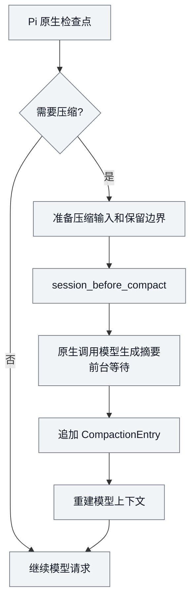
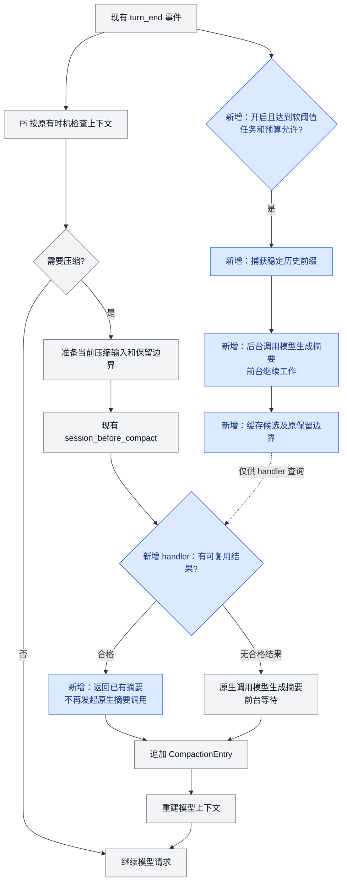

# Async Compaction 技术方案 A：后台准备，原生入口复用

**在 Pi 原来的压缩流程旁增加后台预生成：提前生成摘要，等 Pi 要压缩时校验并复用。** 压缩触发、写入记录和上下文重建仍由 Pi 负责。

| 项目 | 状态 |
| --- | --- |
| 方案 | 已采纳 A 的本地预览设计；参数待评估，产品行为见 [L1](../01-产品定义/扩展/async-compaction-扩展.md) |
| 当前实现 | 独立 package 已接线，默认关闭；已验证范围与剩余验收见 §9 |
| 目标宿主 | Pi 1.0.4 / 1.1.0 的隔离单扩展主 TUI；CLI 与 SDK 验证范围见 §9 |
| 评审证据 | [两轴独立评审及宿主 spike](../归档/评审/2026-10-17-异步压缩-A-双轴评审.md) |

## 1. 原来的流程，方案 A 改动什么

### 1.1 Pi 原来的自动压缩主链

主要等待发生在“调用模型生成摘要”。图示为自动压缩的生成与提交主链；手动和 overflow 的原有控制规则继续适用。

### 1.2 加入方案 A 后

**灰色是 Pi 原有流程，蓝色是扩展新增部分。** 后台结果只进入内存候选，不能直接切换上下文。

候选未完成时，handler 最多等待 §4 约定的时间，再决定返回已有结果还是交还原生生成。正常前台执行不等待后台任务。

### 1.3 改动清单

| 位置 | 新增内容 | 保留的宿主职责 |
| --- | --- | --- |
| 命令入口 | `/async-compact on/off`，仅控制当前主对话 | 不覆盖 `/compact` |
| `turn_end` | 判断软阈值、捕获快照、启动单个后台任务 | 原模型/工具循环继续执行 |
| 内存候选 | 摘要、原保留边界、来源指纹、usage 与任务状态 | 不写入活跃上下文 |
| `session_before_compact` | 校验候选，合格时返回；否则交还原生生成 | 何时压缩、取消和恢复由 Pi 控制 |
| `session_compact` / 失败事件 | 确认实际采用，记录终态和用量 | 原生 CompactionEntry、JSONL 和上下文重建保留 |
| 过程提示 | 生成期间显示 `async-compact` | 不改默认 footer，不设置常驻状态 |

不新增主动接入调度，也不通过 compaction boundary draft 提前提交。候选可以已经 ready，但此时前台仍携带旧上下文，直到原生压缩触发。

### 1.4 接口依据

- 默认路径检查响应错误、输出截断、工具调用和取消信号；候选的来源一致性检查由扩展补充。`firstKeptEntryId` 只标记保留起点。
- 公开的 `getBranch()`、`buildSessionProjection()` 用于读取当前历史；`session_before_compact` 接受 summary、保留边界、usage 和 details。
- `prepareCompaction()` 属于内部实现，未列入核实的 package 根导出。快照准备使用公开投影接口，不直接导入 `dist/core` 私有路径。

依据：[Pi 1.1.0 导出](https://github.com/earendil-works/pi/blob/abe508e1b89912adde45528136c3221eb69acdd7/packages/coding-agent/src/index.ts)、[扩展类型](https://github.com/earendil-works/pi/blob/abe508e1b89912adde45528136c3221eb69acdd7/packages/coding-agent/src/core/extensions/types.ts)、[AgentSession](https://github.com/earendil-works/pi/blob/abe508e1b89912adde45528136c3221eb69acdd7/packages/coding-agent/src/core/agent-session.ts)。本机全局包为 1.0.4，仓库根依赖和 Subagent 的版本不同，需在隔离测试环境验证目标版本。

## 2. 模块与职责

`@pi/async-compaction` 位于 `packages/async-compaction/`，以 `src/index.ts` 作为按需加载入口。

| 模块 | 职责 |
| --- | --- |
| `index.ts` | 注册命令、turn 和原生压缩 hooks；交付候选并确认实际采用 |
| `controller.ts` | 管理开关、会话代际、后台模型请求与响应结算、内存候选、冷却和取消 |
| `compaction.ts` | 稳定前缀选择、摘要提示词构造、文件记录、来源及预算校验 |
| `reporting.ts` | 按需过程提示、用量记录和去重 |

Controller 不直接修改活跃 SessionManager、agent messages 或 JSONL；只有宿主负责提交压缩记录。

## 3. 启动与任务管理

### 启停与来源识别

- `/async-compact on`、`off` 只改变当前主对话的开关，各反馈一次；重复执行保持目标状态。
- 默认 Off，new/resume/fork/reload 后重新 Off，不持久化开关，也不向 child 传递启用参数。宿主自动压缩关闭时不预生成，手动压缩保持原生。
- 首个验证范围为 TUI 主对话。Subagent 的 JSON/print child 不开放启用入口；其他宿主模式需先验证主对话身份，无法区分时保持 Off。1.0.4/1.1.0 的单扩展 native emit 在交付候选后，经连续 Promise microtask 执行同步 append；编辑器提交命令由终端 input 回调同步触发，正常用户的 off 无法插入交付和提交之间。程序化输入及多 handler 不在此证明范围。
- `off` 立即禁止启动和采用，取消本扩展未完成任务；取消后的迟到结果只结算可获得的用量，不进入上下文。

### 后台调度

`turn_end` 只执行有界的快照准备并启动任务，不等待模型结果；只处理已完成的 turn。读取已经持久化的 branch/projection，不把其他 handler 尚未提交的 draft 当作稳定来源。

后台结果回调只把候选置为 ready。即使用户仍在工作，也不从回调直接调用 `ctx.compact()` 或修改会话。`ctx.compact()` 进入手动压缩路径，会先停止当前运行。

摘要函数通过公开的 `ctx.modelRegistry.streamSimple(...).result()` 调用当前物理聊天模型，传入当前 thinking、独立后台 AbortSignal 和 `cacheRetention: "none"`，由 Pi 解析认证和 provider 适配。首版不启用未验证的 virtual model；`complete()` 的 raw stream 路线不作为 simple reasoning 调用替代。用公开的 `serializeConversation`、`convertToLlm` 组织文本及结构化摘要提示词，保留响应状态和已知 usage。

同一会话只运行一个本扩展物理请求。正常新增消息不会取消或重启任务；原生压缩使未提交的候选失效，但不提前释放仍未结算的物理请求槽或写 unknown。普通错误、超时及原生兜底的在途请求从物理结算时、已结算候选从取消时开始至少 60 秒冷却，还需新增约 8000 tokens；已结算的失败或取消发生在原生压缩之前时，原生提交重置每代际次数，但保留失败时钟并以压缩后的当前上下文重建增长基线。基线用量未知则在下次有效调度时先建立基线。候选由宿主成功采用后开启可立即调度的新代际。离开作用域时未结算用量按真实可得情况标记 unknown。

任务状态：`idle → generating → ready → offering → adopted`。`offering` 表示已把候选交给 hook，仍在等待宿主提交确认；失败、取消和丢弃分别进入对应终态。`session_compact_failed` 使 offering 结束，不能停留在“等待采用”。开关独立于任务状态，重复 on 不重置任务或预算。

## 4. 阈值与任务预算

以下是实验起点，不是仓库默认值：

| 参数 | 建议值 / 规则 |
| --- | --- |
| 软阈值 | `min(0.65 × C, 0.8 × H)`；C 为模型窗口，H 为包含宿主预留后的保护边界 |
| 硬限制 | 由 Pi 原生压缩控制；扩展不关闭或抬高该边界 |
| 保留原文预算 | 读取宿主的 `keepRecentTokens`，不另维护一份同名设置 |
| 后台并发 | 每个主会话最多 1 个本扩展任务 |
| 生成超时 | 120 秒 |
| 原生入口等待已有任务 | 最多 2 秒；随后取消候选任务并交还原生路径 |
| 失败后重做 | 至少冷却 60 秒且新增约 8000 tokens；同一压缩代际最多启动 2 次 |
| 模型策略 | 当前实际聊天模型、provider 和 thinking；首版不增加自动模型 fallback |

用 `ctx.getContextUsage()` 和当前模型信息评估软触发，不把物理窗口当作剩余预算。通过 `pi.getSettings()` 读取宿主当前合并/内存设置，逐字段解析型号 override 及 fallback，不另读一份配置文件。采用时与 `preparation.settings` 对账；设置或窗口无法可靠解析时走原生路径。

H 由当前型号窗口减去有效 reserve 得到；输入包括 system/tools 等已有内容。`hasPendingMessages()` 为真而无法取得体积时，拒绝采用候选；新输入尚未落入分支的 preflight 也按未知输入旁路，不能以“队列为空”推定没有即将发送的内容。超大工具结果仍可能一次跨过软硬阈值，交由原生保护与 overflow 恢复处理。

## 5. 快照与覆盖边界

候选保存以下信息，全部属于当前会话的短期内存：

| 信息 | 用途 |
| --- | --- |
| `attemptId`、session identity、extension generation | 标识一次尝试，拒绝旧实例的迟到结果 |
| 快照 leaf、被覆盖的 source entry IDs | 检查当前分支是否仍包含同一历史前缀 |
| 上一份 compaction identity | 防止在另一份摘要已经生效后继续套用旧候选 |
| `firstKeptEntryId` | 候选自己的原文保留起点 |
| 摘要输入 hash | 检查原文、上一份摘要及 context edits 的有效投影是否变化 |
| 模型、endpoint、thinking、system/tools 和设置指纹 | 保守识别摘要环境的变化，不保存凭证 |
| 生成结果、usage、终态和时间 | 用于采用、取消、提示和开销记录 |

选择输入时以 canonical projection 为准，不使用 `getEntries()` 的整棵树。已省略内容不重新混入摘要，替换过的消息按投影后的内容处理。规划线性扫描完整用户段切点，保留有效近期 token 数，按最短非空摘要的乐观下界（保留的 system checkpoint、摘要固定包装和 system/tools 开销）排除无法达到窗口与最低 256 tokens / 前缀四分之一回收要求的切点；对最后一个合格切点及已知文件标签做一次与采用时相同的内存会话模拟，失败则不发请求。已知图像或其他非文本投影在请求前跳过；生成中新增不适用内容仍在接入时拒绝。

建议首版只选完整用户消息段之间的切点，保留至少宿主要求的近期内容；无合适切点或遇到无法完整处理的 split-turn 时，跳过后台任务并保留原生路径。摘要输入包括上一份摘要与本次新覆盖内容，文件操作记录从有效投影提取并累计。上一份由本扩展提交的压缩仅在 details 的 kind、version、attemptId 和两个文件列表通过校验后可复用；其他 hook details 不作结构推断。原生接手时在公开的 `session_before_compact` preparation.fileOps 的 `read`/`edited` Set 补入本扩展上一份已提交列表（包括 manual、overflow、threshold 兜底）；不修改 SessionManager 或原始 entry。Pi 的原生生成器负责形成最终 details 和摘要文件标签。

快照规划函数通过公开的投影接口实现选择；`findCutPoint()` 处理原始 entries 的结果不能直接替代投影语义。若无法用公开接口构造完整的生成输入和文件记录，需要补公开只读 preparation 接缝，而不是复制或深导入宿主内部函数。

## 6. 候选验证与原生提交

### 两种检查分别处理

| 检查 | 处理 |
| --- | --- |
| 生成成功 | 拒绝 error、aborted、输出截断、空文本或包含工具调用的响应 |
| 仍适用当前上下文 | 比对候选归属、当前投影及覆盖关系，不以“请求成功”代替历史校验 |

`session_before_compact` 仅在 `reason === "threshold"` 时尝试复用。普通及带指令的手动 `/compact`、overflow 均取消未完成候选并直接返回 `undefined`，使用原生摘要；已提交文件列表的 preparation 桥独立于候选复用。

threshold 路径依次执行：

1. 开关仍为 On，attempt/session/generation 仍匹配；否则交还原生路径。
2. 重建当前投影，确认被覆盖内容仍为当前分支的有效前缀，输入 hash 和上一份 compaction identity 匹配。仅新增消息可以通过；被覆盖内容发生 context edit 则不通过。
3. 确认候选保留起点仍存在，且不会拆散工具调用与结果；采用候选自己的 `firstKeptEntryId`，不换成当前更靠后的切点。
4. 检查模型和相关配置指纹，并与当前 `preparation.settings` 核对。
5. 在独立的内存 SessionManager 中模拟追加候选，估算“当前 system/tools + 摘要 + 保留原文 + 期间增量 + 必要预留”。队列体积未知、尚有未物化的新输入或设置不匹配时，返回原生路径。
6. 满足空间和回收要求后，返回 `{ compaction: { summary, firstKeptEntryId, tokensBefore, usage, details } }`。`tokensBefore` 使用当前 preparation；details 携带版本和 attemptId。
7. 在 `session_compact` 后检查活动分支中的对应 attemptId，确认实际采用，再结算采用状态。其他 handler 替换了结果时，不能仅凭自己的 hook 返回值宣布成功。

候选仍在生成时只做有界等待；未获得合格结果则返回 `undefined`，让宿主执行原生摘要。取消任务可能晚于网络结算，迟到结果仍需记录可获得的 usage，但不能恢复为 ready。

### 组合边界

原生 hook 也允许其他扩展参与。候选验证到宿主最终提交之间，若其他参与者能修改被覆盖历史，验证就可能过期。首版需要验证支持的 handler 组合；无法证明稳定性时禁用候选采用。要支持任意可变组合，应由宿主提供最终提交前的 expected-context 检查。

## 7. 生命周期、提示与用量

| 事件 / 情况 | 行为 |
| --- | --- |
| 正常追加内容 | 保留候选，采用时重算增量和预算 |
| tree/fork/new/resume/reload、其他压缩已生效 | 推进代际，取消未完成任务，清除旧候选；新会话默认 Off |
| 换模型、provider、system/tools 或相关设置 | 候选保守失效；不自动启动跨厂商请求 |
| 用户停止当前运行 | 终端裸 Esc 或 Pi TUI 识别的 Kitty/CSI-u Esc 触发本扩展的取消，不消费按键或主动中止正常前台推理；停止后的迟到结果只结算用量，不继续留作后续采用 |
| timeout、限流、失败 | 记录终态，释放本扩展任务槽，按预算冷却；原上下文继续有效 |
| shutdown | 禁止启动和采用，取消任务并有界结算已知用量；未结算部分记 unknown，不阻塞退出，不使用失效 context 写入新会话 |

执行摘要时显示 `async-compact generating` 过程提示，hook 等待期间显示 `waiting for background summary`；启用且受支持的 threshold 路径，包括 input preflight 禁止采用的旁路，在交还原生时显示 `native fallback`，原生完成/失败或离开后收起。manual/overflow 仍走宿主原生提示，不标为候选兜底。非模型上下文 custom progress entry 含 attemptId 与渲染 revision；阶段变化和终态用 entry 触发重绘。不占 footer、不抢输入，也不覆盖宿主工作消息或其他 overlay。

每次尝试单独记录已知 usage：SDK 合成的全零用量或没有可证明计量的响应标为 unknown，不解释为免费；error/aborted 响应有正数计量时保存这些值并标为 partial（余量未知）；stop/length/toolUse 的正数计量标为 reported。以物理响应终结状态而非本地取消标志判断完整性，迟到成功响应可为 reported。采用结果的已知 usage 交给原生 CompactionEntry；未采用请求需额外账目，不能假定自动进入原生会话总计。不进入模型上下文的 custom usage entry 记录 attemptId、型号、终态、已知用量及采用关系，详情按需展开，常规行展示已知 input/output/cache/total tokens 与 SDK 估算 cost，展开行显示费用分项及 reasoning/cacheWrite1h 子集；partial 保留已知数和未知余量，unknown 不标为零。已采用计入原生 totals，额外请求单列，避免重复。

候选和原文副本只保存在内存，不新增摘要缓存文件。可持久化的诊断只包含上述最小字段，不保存原始 prompt、headers、provider body 或凭证。进程重启丢弃未采用候选，已采用摘要按宿主会话恢复。

## 8. 验证计划

| 范围 | 验证重点 |
| --- | --- |
| Controller | on/off 幂等、当前主对话范围、child 不启用、单任务、冷却、超时和迟到结果 |
| `compaction.ts` | 追加允许、prefix edit 拒绝、换分支、上一份摘要改变、工具配对、切点衔接及巨大增量 |
| 原生压缩 hooks | 当前 settings/预算复核、普通及带指令 manual/overflow 原生旁路、其他 handler 覆盖、取消与实际采用确认 |
| 用量与恢复 | 采用/丢弃/失败/取消去重，unknown，关闭边界，连续压缩与会话恢复 |
| 真实 Pi 1.0.4 / 1.1.0 | 用实际 SDK/CLI 驱动合成会话验证命令、临时提示、主对话与 child 区分、模型切换和普通摘要调用 |
| 体验基线 | 比较原生与后台模式的全部压缩等待、总任务耗时、额外 tokens 及固定事实保留；包含 miss 与兜底 |

自动化按现有 workspace 接入 `npm test`、`npm run typecheck`。SDK/CLI 合成会话从 `compaction_start` 开始计时，以后续正常任务的 provider 请求开始（排除摘要请求）或明确失败/取消为终点；用 session + 原生压缩序号关联机会，以 details.attemptId 关联实际采用，按 reason 分层，缺少后续请求的样本单列。后台 attempt 的已知 usage、unknown 和原生 totals 分开记录，统计总体见 L1 §7。

首个实验验证“完整用户段可压缩且后台结果 ready”的真实宿主路径，再覆盖超时、巨大工具输出和持续补充输入。真实 provider 费用与速度实验使用合成内容，单独记录配置和用量；离线 fake provider 证据不当作真实网络性能。

## 9. 实现差距与采纳项

| 目标 / 问题 | 当前事实 | 处理 |
| --- | --- | --- |
| 后台生成、验证、原生接入 | `packages/async-compaction/src/` 已实现完整用户切点、有效投影 hash、原生 threshold hook；离线 fake provider 连续两次相同摘要的实际提交已验证 | 失败/overflow 组合与其他 handler 条件提交仍需验证；仅隔离 CLI profile 允许采用 |
| 原生压缩入口复用 | 已注册 threshold hook 并交还 Pi 提交；单次隔离 SDK 命中已验证 | 以候选复用率、全量压缩等待及原生行为兼容为验收输入 |
| 主对话识别与提示 | 命令仅接受 TUI、指定版本的实际 CLI 路径、`--no-extensions -e packages/async-compaction/src/index.ts` 且单一显式 extension；Pi 1.0.4 实际 CLI + PTY、本地合成 SSE 验证启停、阶段重绘与编辑草稿保留；1.0.4/1.1.0 SDK 验证裸 Esc 和 Kitty/CSI-u Esc | 其他启动组合未开放；人工物理终端体验见效果验收项 |
| 宿主有效设置、待发送输入预算 | 使用内存 SettingsManager 解析有效设置；pending 和 input preflight 屏障、post-run 窗口限制候选，模拟独立内存会话追加候选。`getContextUsage()` 无法给出当前压力时保守跳过后台任务；未启用投影估算触发 | 未验证其它入口与持续队列下预算安全性 |
| 投影准备与文件记录 | 公开 canonical projection 选择完整用户段；本扩展的版本化 details 及有效工具调用用于累计。原生跳过 fromHook details 时，在公开 preparation.fileOps 补前一份已提交且校验通过的列表，原生负责写回结构化 details/标签；离线 SDK manual 接续验证不依赖模型输出路径 | split-turn 与工具调用/结果边界全集尚未验证；其他 hook 的 details 不猜测 |
| 多扩展最终提交一致性 | 缺 expected-context 条件；仅接受 1.0.4 或 1.1.0、`--no-extensions` 且单个显式 `-e` 指向本入口；不能运行时证明 SDK 注入的其它 handler 不存在 | 多扩展模式禁用候选；扩大到任意组合需宿主最终 CAS |
| 额外 usage 进入会话总账 | 同 session 物理请求结算后追加非上下文 custom entry，含 reported/partial/unknown 计量状态；原生 fallback 期间仍 pending 时保留物理槽，晚到计量按原 provider/model 单次记录并从结算时重新起算冷却和压缩后增长；离开前未结算请求写 unknown，采用 usage 随原生 compaction 记录 | 退出后迟到用量无法安全写回原会话；真实退出时序仍需验证 |
| 真实宿主命中 | 两版本公开 SDK 验证连续 threshold 提交、文件接续及恢复；Pi 1.0.4 实际 CLI 验证候选旧切点、同一 SessionId、JSONL 原文保留、期间用户及工具增量，以及重开后默认 Off 和旧进度隐藏 | fork/reload 等其余真实 CLI 恢复组合未单独验收 |
| 阶段提示与开销 | 过程 entry 按 generating/waiting/native fallback 渲染；实际 CLI 验证等待/兜底期间可见、终态无需新输入收起，后台结算不清除前台阶段；已知数值及 native/extra/unknown 归属可见 | 真实 provider 的异常和用量形态仍需验收 |
| 参数与效果门槛 | 默认 Off；1.0.4/1.1.0 类型与合成 SDK 验证、Pi 1.0.4 定向 CLI/PTY 协议验收已完成 | L1 A12 的完整任务效果基线（完整 threshold 总体、总耗时/tokens、事实与约束保留）尚未验收；真实厂商摘要质量、费用、网络性能及人工物理终端体验未测；多 handler 最终 CAS 未实现，非隔离加载不开放 |

外部实现和图示见 [调研报告](../归档/研究/2026-10-17-异步上下文压缩调研.md)。研究阶段的 [路线比较](../归档/评审/2026-10-17-异步压缩-需求与方案对齐.md)保留为证据；产品规则由 L1 拥有，运行事实以后续源码和测试为准。
