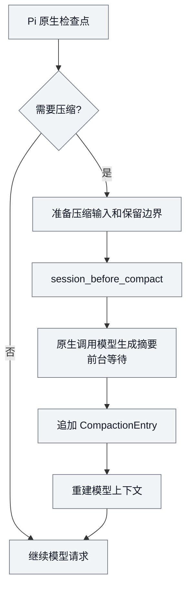
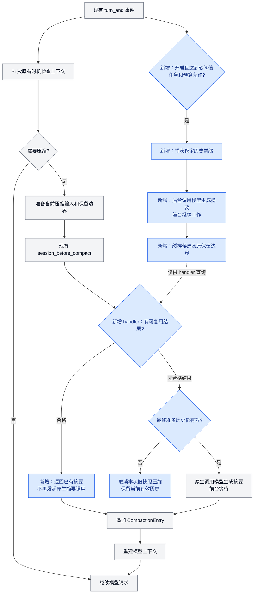

# Async Compaction 技术方案 A：后台准备，原生入口复用

**在 Pi 原来的压缩流程旁增加后台预生成：提前生成摘要，等 Pi 要压缩时校验并复用。** 压缩触发、写入记录和上下文重建仍由 Pi 负责。

| 项目 | 状态 |
| --- | --- |
| 产品依据 | [L1](../01-产品定义/扩展/async-compaction-扩展.md)：本机统一开关、全部 Pi Agent 与压缩耗时 |
| 当前源码 | 本包实现完整回复/工具轮调度、候选 fencing、600 秒共享生成预算、原生入口等待与复用、阶段计量及安全本地诊断；SDK Worker 的 managed factory 接线不等于非 TUI 后台调度已开放 |
| 当前准入 | CLI 版本由 `supportedHost()` 核验，后台调度仍要求 TUI；不要求 `--no-extensions` 单扩展 profile。已直接验证 Pi 1.0.4 / 1.1.0，peer 范围不代表每个 patch 都已验证 |
| 验证边界 | Pi 1.1.0 类型检查及 1.0.4/1.1.0 的合成 SDK/TUI 路径已有证据；真实 provider 性能、实际用户终端、全部 Agent 接线及任意第三方组合仍未验收 |

## 0. 全部 Agent 的目标接线（评审中）

### 0.1 既有扩展内改造

- 在 `packages/async-compaction/` 内拥有本机偏好读写、每个 Agent 的 Controller、压缩阶段计时和显示。`index.ts` 按入口适配，`controller.ts` 管理任务，`timing.ts` 保留后台/前台阶段计量，通用耗时由本包的 `duration.ts` 承载。
- 不新增独立状态扩展、共享状态 package 或额外用户控制入口。偏好读写与压缩耗时均留在本包；Fast 包不再装载 Async 的 observer，避免双重职责和重复记录。
- 持久意图使用本机固定 `<本机 agentDir>/settings.json` 的 `myPiExtensions.asyncCompaction`，缺省 `false`；完整片段由 [L3](../03-项目落地/项目配置.md#本机功能开关)拥有。所有 Agent 取同一全局来源，不接受项目合并值或 child 临时 agentDir 覆盖；与 Fast 共用文件但不共用任务状态。
- 命令与手动编辑修改同一字段。包内读写须协调 Pi 宿主文件锁、锁内重读，只更新本字段并保留 Fast、其他扩展和全部原生设置；不使用旧内存快照覆盖全文，也不借 child SettingsManager 改写全局模型。原生字段容纳能力已核实，协同写锁、路径传递与实际功能接线仍需验证。
- 本机开关、每个 Agent 的实际能力条件、任务状态分别处理。模式与 UI 不再是启用资格；模型、有效压缩设置、当前上下文及可证明的安全接入条件仍需检查。全机 On 不等于每个 Agent 立即调用模型。

### 0.2 入口适配矩阵

| 入口 | 目标接线 | 保留的边界 |
| --- | --- | --- |
| 主 TUI | 用户命令保存本机设置，按需显示进度与耗时 | 不新增常驻状态，不抢输入或修改原生摘要 |
| RPC | 自动读取本机设置，按该入口现有协议反馈 | 不依赖终端键盘监听，不把缺 TUI 当 Off |
| JSON / print 子 Agent | 自动读取本机设置，按同样触发条件准备/采用候选 | 保留结构化协议、取消、有限退出及本地记录，不向 stdout 混入自由文本诊断 |
| 继续、重试、备用模型 | 同一本机设置；按实际模型重新核验，旧候选不能跨模型/会话复用 | 不重置 retry/fallback 预算，不额外修改宿主模型 |
| SDK Worker | 通过实际 ResourceLoader/ExtensionRunner 接线，取消和关闭跟随该 Worker | 保留 Node 工具/Skill allowlist、独立历史及 Artifact 控制，不靠只修改 CLI argv 声称已覆盖 |
| 显式 allowlist / recovery child | 把所需扩展加入经过证明的加载组合 | 不取消 `--no-extensions`、加载顺序、side-effect interceptor 或完整性检查 |

### 0.3 任务、配置与展示边界

- 每个 Agent 独立持有候选、scope/generation、在途物理请求槽、冷却、usage 与阶段记录；共享的只是本机开关，不能共享私有原文、摘要或任务身份。现有单任务/冷却参数按 Agent 适配；本机总并发和总费用没有新增上限承诺。
- 新建或成功替换 Agent 时读取同一本机偏好；结束只清本实例，不把全机 Off 写回。可取消的导航前置事件不能永久关闭当前能力；成功 tree 才隔离旧 branch。reload 依宿主先 shutdown 再加载的事实处理，失败不声称旧实例仍在运行。
- 已确认在下一模型请求、后台调度或候选采用前刷新适用设置，不要求再次输入、重启或重开 Agent。接受 Off 后统一取消/fence 旧候选；物理请求只能尽力取消，迟到结果结算已知用量但不接入。不能只依赖启动快照、文件事件或 input 刷新；读失败/值无效则停止新增后台任务和采用、走原生路径；保存失败不改持久真值、不阻断业务。
- 计时核心不依赖 UI；凡呈现 `[compaction]` 的入口，使用同次本地记录显示阶段耗时。无 UI 的 Agent 保留本地诊断，不要求所有子过程灌入主对话。所有入口需验证不改变原生返回、摘要、费用或取消。
- 扩大到尚未支持的入口前必须证明真实提交安全。受支持 threshold 路径返回延迟 `cancel` getter，即使没有候选也在宿主消费时核验准备历史；历史已变时取消本次压缩，而不以过期 preparation 原生兜底。有候选时由 `compaction` getter 继续核验分支、模型/工具/设置、候选身份和最新本机开关。结果优先级、旁路及后置覆盖的边界见 §6；1.0.4/1.1.0 的真实 SDK 合成测试只覆盖已有组合，不代表任意第三方扩展或未来宿主均已验证，不能删除 guard 冒充完成。
- 本地通用耗时与 CF producer 分开。显式采集许可下，主/子 Agent 的两类阶段事件由真实终态产生，操作开始时捕获有限 agentType；通用 observer 不调用项目指标投递器。数据字段和兼容由项目指标 L2 拥有。

§1–§7 描述当前源码机制；与以上目标的差距和验收集中见 §8–§9。

## 1. 原来的流程，方案 A 改动什么

### 1.1 Pi 原来的自动压缩主链

主要等待发生在“调用模型生成摘要”。图示为自动压缩的生成与提交主链；手动和 overflow 的原有控制规则继续适用。

### 1.2 加入方案 A 后

**灰色是 Pi 原有流程，蓝色是扩展新增部分。** 后台结果只进入内存候选，不能直接切换上下文。

候选未完成时，handler 最多等待 §4 约定的时间，再决定返回已有结果还是交还原生生成。正常前台执行不等待后台任务。

### 1.3 改动清单

| 位置 | 新增内容 | 保留的宿主职责 |
| --- | --- | --- |
| 当前命令入口 | `/async-compact on/off` 在受支持 CLI 的主 TUI 保存本机偏好；非 TUI 完整接线仍有差距 | 不覆盖 `/compact` |
| `turn_end` | 完整回复或已持久化完整工具轮检查软阈值、捕获快照并启动单个后台任务 | 原模型/工具循环继续执行，不等待后台结果 |
| 内存候选 | 摘要、原保留边界、来源指纹、usage 与任务状态 | 不写入活跃上下文 |
| `session_before_compact` | 校验候选；参与的 threshold 路径无候选时仍保留最终历史守卫，历史有效才交还原生生成 | 何时压缩、取消和恢复由 Pi 控制；返回结果按宿主扩展顺序选用 |
| `session_compact` / 失败事件 | 确认实际采用，记录终态和用量 | 原生 CompactionEntry、JSONL 和上下文重建保留 |
| 过程提示 | 生成期间显示 `async-compact` | 不改默认 footer，不设置常驻状态 |

不新增主动接入调度，也不通过 compaction boundary draft 提前提交。候选可以已经 ready，但此时前台仍携带旧上下文，直到原生压缩触发。

### 1.4 接口依据

- 默认路径检查响应错误、输出截断、工具调用和取消信号；候选的来源一致性检查由扩展补充。`firstKeptEntryId` 只标记保留起点。
- 公开的 `getBranch()`、`buildSessionProjection()` 用于读取当前历史；`session_before_compact` 接受 summary、保留边界、usage 和 details。
- `prepareCompaction()` 属于内部实现，未列入核实的 package 根导出。快照准备使用公开投影接口，不直接导入 `dist/core` 私有路径。

依据：[Pi 1.1.0 导出](https://github.com/earendil-works/pi/blob/abe508e1b89912adde45528136c3221eb69acdd7/packages/coding-agent/src/index.ts)、[扩展类型](https://github.com/earendil-works/pi/blob/abe508e1b89912adde45528136c3221eb69acdd7/packages/coding-agent/src/core/extensions/types.ts)、[AgentSession](https://github.com/earendil-works/pi/blob/abe508e1b89912adde45528136c3221eb69acdd7/packages/coding-agent/src/core/agent-session.ts)。Fast、Async 与 SDK Worker 的宿主解析不同，目标兼容矩阵须独立验证，不以某台电脑的全局安装替代。

## 2. 模块与职责

`@pi/async-compaction` 位于 `packages/async-compaction/`，以 `src/index.ts` 作为按需加载入口。

| 模块 | 职责 |
| --- | --- |
| `index.ts` | 注册命令、turn 和原生压缩 hooks；交付候选并确认实际采用 |
| `controller.ts` | 管理开关、会话代际、单物理请求、单调生成 deadline、可取消等待、候选与实际采用、冷却及迟到结算 |
| `compaction.ts` | 稳定前缀选择、摘要提示词构造、文件记录、来源及预算校验 |
| `reporting.ts` | 有界调度原因、过程阶段、取消/失败分类、用量记录和去重；均为非模型上下文本地诊断 |
| `tool-turn.ts` | 核对工具调用与结果的完整性、成功状态及已持久化 entry 身份 |
| `timing.ts` | Async 后台生成与符合条件的 threshold 前台阶段计时、epoch 隔离及历史 renderer |
| `duration.ts` | 当前主 TUI 的通用阶段 observer 与 renderer 候选；目标扩展到全部入口，本地记录不使用 project-metrics |
| `packages/async-compaction/src/machine-settings.ts`、`duration-schema.ts` | 本包专用偏好 I/O 与耗时合同；不引入共享状态层 |

Controller 不直接修改活跃 SessionManager、agent messages 或 JSONL；只有宿主负责提交压缩记录。

## 3. 当前启动与任务管理

以下 gate 是现有源码的安全限制，不能作为 L1 排除子 Agent 的产品规则；目标适配见 §0，未完成项见 §9。

### 启停与来源识别

- `/async-compact on`、`off` 在支持版本的主 TUI 更新本机全局 `settings.json.myPiExtensions.asyncCompaction`；路径可由可信启动器或 managed factory 明确传入。项目设置不覆盖该字段，缺省关闭，重复命令不重置任务预算。
- session_start、input、turn_start、调度及候选采用前刷新偏好。缺失、损坏或字段无效时停止新增生成和采用，保留原生路径；正常退出和 scope reset 不写回 Off。保存失败提示本机保存未确认，不覆盖无关配置。
- 当前后台调度仍要求 TUI，命令还核验 CLI host。非 TUI 能读取偏好不等于已经支持后台生成；全部 Agent 的产品目标及缺口见 §9.1。正常 CLI 加载不要求 `isolatedProfile()`，具体组合的提交安全依据见 §6。
- `off` 立即禁止启动和采用、唤醒当前等待并尽力取消旧请求，但允许宿主原生压缩；迟到结果只结算可获得用量，不恢复候选。

### 后台调度

`turn_end` 只执行有界快照准备并启动任务，不等待模型结果。assistant `stop` 可进入检查；`toolUse` 必须通过 `hasCompletedToolTurn()`：调用与结果完整配对、结果成功，且事件 entry 身份与已持久化 branch 一致。事件或持久化结果任一 `isError === true` 均拒绝预热，不能以协议完整或 `outcome: completed` 代替业务成功。不完整或中止轮也不新增准备机会，不把其他 handler 尚未提交的 draft 当作稳定来源。

调度诊断记录有限 `reason`、`trigger`、当前 mode、有效开关及已知的 tokens/window/reserve/软硬边界。`assistant_stop`、`completed_tool_turn`、`threshold_offer` 与未知来源分开；中止、排队、无模型、有效设置不可用、用量未知、物理槽、已就绪候选、冷却、增长和快照拒绝等不混作同一原因。按代际及原因有界去重，低压力重复检查不耗尽后续高压力原因的容量；达到容量时以有限的饱和记录说明遗漏。记录失败不影响原调度，不新增空闲可见提示或远端采集。

后台结果回调只把候选置为 ready。即使用户仍在工作，也不从回调直接调用 `ctx.compact()` 或修改会话。`ctx.compact()` 进入手动压缩路径，会先停止当前运行。

摘要函数通过公开的 `ctx.modelRegistry.streamSimple(...).result()` 调用当前物理聊天模型，传入当前 thinking、独立后台 AbortSignal 和 `cacheRetention: "none"`，由 Pi 解析认证和 provider 适配。首版不启用未验证的 virtual model；`complete()` 的 raw stream 路线不作为 simple reasoning 调用替代。用公开的 `serializeConversation`、`convertToLlm` 组织文本及结构化摘要提示词，保留响应状态和已知 usage。

同一会话只运行一个本扩展物理请求。正常新增消息不会取消或重启任务；原生压缩使未提交的候选失效，但不提前释放仍未结算的物理请求槽或写 unknown。普通错误、超时及原生兜底的在途请求从物理结算时、已结算候选从取消时开始至少 60 秒冷却，还需新增约 8000 tokens；已结算的失败或取消发生在原生压缩之前时，原生提交重置每代际次数，但保留失败时钟并以压缩后的当前上下文重建增长基线。基线用量未知则在下次有效调度时先建立基线。候选由宿主成功采用后开启可立即调度的新代际。离开作用域时未结算用量按真实可得情况标记 unknown。

任务状态：`idle → generating → ready → offering → adopted`。`offering` 表示已把候选交给 hook，仍在等待宿主提交确认；失败、取消和丢弃分别进入对应终态。`session_compact_failed` 使 offering 结束，不能停留在“等待采用”。开关独立于任务状态，重复 on 不重置任务或预算。

## 4. 阈值与任务预算

以下是当前预览实现使用的参数与规则；功能默认关闭，不新增用户级参数配置：

| 参数 | 当前值 / 规则 |
| --- | --- |
| 软阈值 | `min(0.65 × C, 0.8 × H)`；C 为模型窗口，H 为包含宿主预留后的保护边界 |
| 硬限制 | 由 Pi 原生压缩控制；扩展不关闭或抬高该边界 |
| 保留原文预算 | 读取宿主的 `keepRecentTokens`，不另维护一份同名设置 |
| 后台并发 | 每个主会话最多 1 个本扩展任务 |
| 生成总预算 | 600 秒，从实际调用后台 SDK 前以单调时钟建立一次绝对 deadline；与诊断计时独立 |
| 原生入口等待已有任务 | 仅等待同一合格在途任务的剩余生成预算，不重新计时；已 ready 直接校验复用，无候选/失败/失效/到期则走原生 |
| 失败后重做 | 至少冷却 60 秒且新增约 8000 tokens；同一压缩代际最多启动 2 次 |
| 模型策略 | 当前实际聊天模型、provider 和 thinking；首版不增加自动模型 fallback |

用 `ctx.getContextUsage()` 和当前模型信息评估软触发，不把物理窗口当作剩余预算。通过 `pi.getSettings()` 读取宿主当前合并/内存设置，逐字段解析型号 override 及 fallback，不另读一份配置文件。采用时与 `preparation.settings` 对账；设置或窗口无法可靠解析时走原生路径。

H 由当前型号窗口减去有效 reserve 得到；输入包括 system/tools 等已有内容。`hasPendingMessages()` 为真而无法取得体积时，拒绝采用候选；新输入尚未落入分支的 preflight 也按未知输入旁路，不能以“队列为空”推定没有即将发送的内容。运行中 steering/follow-up 每次进入 input 即登记一个未物化输入；user `message_end` 仅登记去重后的物化对象，待所有输入都有对应对象出现在活动分支且队列已空后才解除 preflight。较早消息不能解除较新输入的门禁，不能把事件发生等同于已经持久化；等待结束及最终候选 getter 再次核验，期间新增未物化输入则保留原生路径。被其他输入 handler 截获、失败或无法配对的输入保守阻止当前作用域复用，直到作用域重置；`agent_start` 不清计数，避免首条消息误消耗较新输入的证据。不按文本猜测对应关系。已进入等待后即使发现未物化输入，也保留即时及最终历史守卫，历史过期时取消而不使用旧 preparation 原生兜底。已物化历史的运行中 next-turn 与 post-run 自动 threshold 可以等待，不再只限 post-run 窗口。超大工具结果仍可能一次跨过软硬阈值，交由原生保护与 overflow 恢复处理。

等待同时竞争物理结果、剩余 deadline、宿主压缩 signal、本地取消及作用域 signal，并在退出时清理最初注册对象上的监听。用户/宿主取消结束当前压缩，不以原生兜底抵消取消；Off 允许原生继续。正常结束会清理生成 timer，截止竞争只使候选终态化一次。到期仅尽力 abort，物理请求未结算时仍占槽，迟到用量按真实结果单次结算；600 秒不包含随后原生兜底的耗时。

## 5. 快照与覆盖边界

候选保存以下信息，全部属于当前会话的短期内存：

| 信息 | 用途 |
| --- | --- |
| `attemptId`、session identity、extension generation | 标识一次尝试，拒绝旧实例的迟到结果 |
| 快照 leaf、被覆盖的 source entry IDs | 检查当前分支是否仍包含同一历史前缀 |
| 上一份 compaction identity | 防止在另一份摘要已经生效后继续套用旧候选 |
| `firstKeptEntryId` | 候选自己的原文保留起点 |
| 摘要输入 hash | 检查原文、上一份摘要及 context edits 的有效投影是否变化 |
| 模型、endpoint、thinking、system/tools 和设置指纹 | 保守识别摘要环境的变化，不保存凭证 |
| 生成结果、usage、终态和时间 | 用于采用、取消、提示和开销记录 |

选择输入时以 canonical projection 为准，不使用 `getEntries()` 的整棵树。已省略内容不重新混入摘要，替换过的消息按投影后的内容处理。规划线性扫描完整用户段切点，保留有效近期 token 数，按最短非空摘要的乐观下界（保留的 system checkpoint、摘要固定包装和 system/tools 开销）排除无法达到窗口与最低 256 tokens / 前缀四分之一回收要求的切点；对最后一个合格切点及已知文件标签做一次与采用时相同的内存会话模拟，失败则不发请求。已知图像或其他非文本投影在请求前跳过；生成中新增不适用内容在进入等待和接入前均拒绝。

建议首版只选完整用户消息段之间的切点，保留至少宿主要求的近期内容；无合适切点或遇到无法完整处理的 split-turn 时，跳过后台任务并保留原生路径。摘要输入包括上一份摘要与本次新覆盖内容，文件操作记录从有效投影提取并累计。上一份由本扩展提交的压缩仅在 details 的 kind、version、attemptId 和两个文件列表通过校验后可复用；其他 hook details 不作结构推断。原生接手时在公开的 `session_before_compact` preparation.fileOps 的 `read`/`edited` Set 补入本扩展上一份已提交列表（包括 manual、overflow、threshold 兜底）；不修改 SessionManager 或原始 entry。Pi 的原生生成器负责形成最终 details 和摘要文件标签。

快照规划函数通过公开的投影接口实现选择；`findCutPoint()` 处理原始 entries 的结果不能直接替代投影语义。若无法用公开接口构造完整的生成输入和文件记录，需要补公开只读 preparation 接缝，而不是复制或深导入宿主内部函数。

## 6. 候选验证与原生提交

### 两种检查分别处理

| 检查 | 处理 |
| --- | --- |
| 生成成功 | 拒绝 error、aborted、输出截断、空文本或包含工具调用的响应 |
| 仍适用当前上下文 | 比对候选归属、当前投影及覆盖关系，不以“请求成功”代替历史校验 |

`session_before_compact` 仅在 `reason === "threshold"` 时尝试复用。普通及带指令的手动 `/compact`、overflow 均取消未完成候选并直接返回 `undefined`，使用原生摘要；已提交文件列表的 preparation 桥独立于候选复用。

threshold 路径依次执行：

1. 开关仍为 On，attempt/session/generation 仍匹配；否则交还原生路径。
2. 重建当前投影，确认被覆盖内容仍为当前分支的有效前缀，输入 hash 和上一份 compaction identity 匹配。仅新增消息可以通过；被覆盖内容发生 context edit 则不通过。
3. 确认候选保留起点仍存在，且不会拆散工具调用与结果；采用候选自己的 `firstKeptEntryId`，不换成当前更靠后的切点。
4. 检查模型和相关配置指纹，并与当前 `preparation.settings` 核对。
5. 在独立的内存 SessionManager 中模拟追加候选，估算“当前 system/tools + 摘要 + 保留原文 + 期间增量 + 必要预留”。队列体积未知、尚有未物化的新输入或设置不匹配时，返回原生路径。
6. 满足空间和回收要求后，返回 `{ compaction: { summary, firstKeptEntryId, tokensBefore, usage, details } }`。`tokensBefore` 使用当前 preparation；details 携带版本和 attemptId。
7. 在 `session_compact` 后从活动分支定位本次边界之后的新 compaction entry，核对已提交 details 的 kind/version/attemptId、文件列表、scope/generation、摘要和保留切点，再单次结算采用。宿主事件可能引用较早的同文 entry，不能直接据此关联。其他 handler 提交相同摘要和切点也不构成采用证据；不事后改写宿主 entry 来补造身份，恢复后的 JSONL 必须保有相同身份。

候选仍在生成时只等待其剩余生成预算；等待前以最短非空摘要及必需文件标签执行 `fits()`，已知超大或非文本尾部等使乐观下界也不合格时不创建等待 timer。等待结束及宿主最终消费返回对象时，核对原始 preparation 的模型可见投影；已变化则取消，不能交给旧 preparation 原生生成。没有合格结果时也返回动态 `cancel` 守卫：历史未变则让宿主原生生成，后置 handler 编辑了历史则取消本次压缩。该守卫不增加模型调用，不扩大到入口 Off、未知输入 preflight、manual/overflow 等原有旁路。当前操作被用户、宿主或作用域取消时也返回取消结果，不另起原生摘要。取消信号与物理结算分开，迟到结果保留可得 usage，但不能恢复为 ready。

### 组合边界

Pi 1.1.0 的 runner 依次 await handler，并保留最后一个非空返回对象；每个 handler 返回后检查 `cancel`，不提前读取 `compaction` getter。宿主在所有 handler 完成后再检查 `cancel` 并读取候选；候选成立后的字段读取、abort 检查和 append 之间无 await。扩展返回对象通过最终 `cancel` getter 拒绝过期准备历史；有候选时在 `compaction` getter 同步刷新偏好和执行 `canAdopt()`。后置 handler 覆盖整个返回对象时，本扩展的守卫不再拥有最终裁决，也不能误报本扩展 adopted。

无候选路径采用 L1 的安全优先规则：在本扩展参与的受支持 threshold 入口仍交付最终准备历史校验，允许该返回对象覆盖更早 handler 的 compaction。历史未变时可以走原生生成，已变时取消本次压缩；检查本身不调用模型，不保证保留更早扩展的摘要收益。不修改 Pi SDK，也不增加单扩展 profile 限制。

现有 SDK 合成测试覆盖候选获胜、无候选/生成失败/不合格尾部的后置编辑、历史未变时的原生兜底、前置候选覆盖、后置覆盖、同文碰撞及 JSONL 恢复；这不是任意第三方组合、未来宿主或恶意篡改的保证。后置 handler 若覆盖整个结果，须独立验证其提交安全；宿主时序无法证明安全时不能直接用可能过期的 preparation 兜底。

## 7. 生命周期、提示与用量

| 事件 / 情况 | 行为 |
| --- | --- |
| 正常追加内容 | 保留候选，采用时重算增量和预算 |
| 成功 tree | 使旧候选和阶段 observer 失效；保留未结算物理请求槽直至迟到响应结算，按原 branch leaf fence 禁止旧任务计量/提示写入新分支，然后刷新本机偏好 |
| new/resume/fork | 成功替换时 shutdown 清理旧实例，新 `session_start` 重新读取偏好；取消导航前置事件不执行 leave/reset，不卸载仍有效的输入监听 |
| reload | 宿主先 shutdown 旧实例，再重载资源；成功的新 `session_start` 读取偏好，失败不保证旧实例可继续，但不得写回本机 Off |
| 换模型、provider、system/tools 或相关设置 | 候选保守失效；不自动启动跨厂商请求 |
| 用户停止当前运行 | 终端裸 Esc 或 Pi TUI 识别的 Kitty/CSI-u Esc 记录用户取消，不消费按键；当前等待及时结束且不自动原生兜底。宿主中止、Off、导航和 manual/overflow 的候选退场分别归因，取消意图不串到下一次压缩；迟到结果只结算用量 |
| timeout、限流、失败 | 到期仅请求取消；物理调用结算前仍占任务槽，结算后才释放并按预算冷却，迟到用量单次处理；原上下文继续有效 |
| shutdown | 禁止启动和采用，取消任务并有界结算已知用量；未结算后台计时以 `scope_left` 记 unknown，不阻塞退出，不使用失效 context 写入新会话 |
| timing scope | Async 后台/threshold 阶段计时与通用 `compaction-duration` observer 分开。前者不随 Off、Esc 或 native commit 截断；后者在主 TUI 对 manual/threshold/overflow 开始独立单调计时，不依赖 Async 开关。shutdown 可在原 scope 记录 unknown；成功 tree 直接丢弃旧 branch 诊断，避免写入新分支。RPC/JSON/headless 不写通用行 |

执行摘要时显示 `async-compact generating`，hook 等待期间显示 `waiting for background summary`；启用且受支持的 threshold 路径，包括 input preflight 旁路，在交还原生时显示 `native fallback`，终态或离开后收起。manual/overflow 使用宿主原生提示。非模型上下文 progress entry 含 attemptId、revision 和有限 phase，生成、等待、原生兜底及隐藏状态可在历史中区分；恢复历史不复活已结束的进度。不占 footer、不抢输入，也不覆盖其他工作消息。

每次尝试单独记录已知 usage：SDK 合成的全零用量或没有可证明计量的响应标为 unknown，不解释为免费；error/aborted 响应有正数计量时保存这些值并标为 partial（余量未知）；stop/length/toolUse 的正数计量标为 reported。以物理响应终结状态而非本地取消标志判断完整性，迟到成功响应可为 reported。采用结果的已知 usage 交给原生 CompactionEntry；未采用请求需额外账目，不能假定自动进入原生会话总计。不进入模型上下文的 custom usage entry 记录 attemptId、型号、终态、已知用量及采用关系，详情按需展开，常规行展示已知 input/output/cache/total tokens 与 SDK 估算 cost，展开行显示费用分项及 reasoning/cacheWrite1h 子集；partial 保留已知数和未知余量，unknown 不标为零。已采用计入原生 totals，额外请求单列，避免重复。

候选和原文副本只保存在内存，不新增摘要缓存文件。调度、progress、取消、失败、usage 及阶段耗时诊断通过 Pi 非模型上下文 custom entry 写入 Session JSONL，不新增数据库或传输。取消使用 deadline/user/host/off/scope/native/unknown 等有限分类；失败只保留阶段、stopReason、有限内容类型及长度统计、允许的错误分类/HTTP 状态，不保存原始错误文本或 provider body。未知用量不解释为零消耗，诊断故障不能替代业务终态；阶段记录为 schemaVersion 1，包含 sampleId、kind、startedAtUTC（时钟不可读时为 null）、durationMs、outcome、model/provider 和有限 unknownReason；时钟无效或物理终态不可观察时，durationMs 为 null 且 outcome 为 unknown，不伪造纪元时间或零耗时。不保存会话标识、原始 prompt、headers、provider body 或凭证。后台生成从 streamSimple 调用前开始，在 result resolve/reject 第一时间单调计时结算；前台阶段从符合条件的 threshold handler 入口开始，到宿主 compact/compact_failed 入口结算。阶段结束后以两个独立 renderer 标签显示秒数或“未知”。`reporting.ts` 对 progress/usage append 的公共出口做 best-effort 隔离，Controller 与命令提示异常也不传播到模型/原生 hook；诊断写入失败时不宣称记录成功、不补造样本、不重试，继续既有候选、取消、usage 与原生压缩路径。进程重启丢弃未采用候选，已采用摘要按宿主会话恢复；`--no-session` 记录仅在当前进程可见。

### 后台失败诊断

后台失败通过 `async-compact-failure` 非模型上下文 custom entry 留在当前 Session，`schemaVersion: 1`、`attemptId` 与对应 usage 关联。它说明可观察到的失败阶段和响应形态，不等于已确定 provider 根因；历史记录缺失时不回填，也不从诊断恢复任务。

| 字段 / 路径 | 当前记录边界 |
| --- | --- |
| `stage` | `stream_simple` 调用、`result` 观察/拒绝、`response` 校验、`response_processing` 本地处理 |
| `reason` | 非正常结束、空文本、仅思考、非预期内容、畸形响应、同步抛错、Promise 拒绝、本地处理异常或未知；使用固定枚举 |
| `stopReason` | `stop`、`length`、`toolUse`、`error`、`aborted`；其它值归为 `other`，不可读取归为 `unknown` |
| `content` | 白名单块类型计数与文本字符长度，不保存正文；最多检查 256 个块、累计文本长度上限 1,000,000，超限标记 `truncated`，无法完整计算的数量或长度为 `null` |
| `errorCategory` / `httpStatus` | 仅保留白名单异常类别、网络错误码及有限 HTTP 错误状态；其它值为 `unknown` 或 `null`。不解析或保留任意异常文本 |
| 展示与存储 | 可见行只显示阶段、原因、结束类型；不记录请求/响应 ID、原文、思考正文、工具参数、stack、headers 或原始 provider 响应；不新增远端指标字段或投递 |
| 故障隔离 | 提取和写入为 best-effort，与 usage 分别写入且按 attempt 去重；只在原作用域可安全记账时追加，离开后的迟到结果不写入新 Session/分支 |

物理生成计时、attempt 的取消/采用结果和失败诊断是不同事实。正常物理响应后本地处理异常可以同时出现 `completed` 阶段耗时、`processing_error` 诊断和失败的 attempt；取消后的迟到成功也不重新生成候选。响应已明确为 aborted 时可留 `non_stop` 诊断，但仅本地取消并不伪造模型失败。候选必须包含非空文本，且每个文本块均为字符串；畸形文本不接入原生上下文。

这些分类由离线测试验证；真实 provider 请求、历史失败的具体根因与安装后的真实 TUI 展示未由这些测试证明。

## 8. 验证计划

| 范围 | 验证重点 |
| --- | --- |
| Controller | 全部主/子 Agent 采用本机 on/off；latent On 不绕过实际模型/设置；取消导航与成功 tree、每 Agent 单任务、冷却、超时和跨 branch 迟到结果。旧“child 不启用”断言只证明当前 gate，须替换为目标适配验收 |
| `compaction.ts` | 追加允许、prefix edit 拒绝、换分支、上一份摘要改变、工具配对、切点衔接及巨大增量 |
| 工具回合预生成 | Pi 1.1.0 SDK 与内存 fake provider 覆盖多工具结果持久化后启动、后台未结算时前台继续、重复回合不绕过物理槽；资格检查与入口测试覆盖工具业务错误拒绝、异常终态、不完整关联、开关刷新及软阈值。真实 provider 性能与摘要质量未验证，不据此声明压缩等待减少 |
| 原生压缩 hooks | 已物化历史的 next-turn/post-run 同任务等待、未知 preflight 旁路、600 秒剩余预算与截止竞争、Esc/Off/宿主取消、manual/overflow、后置 handler 改历史或覆盖、实际采用及 JSONL 身份恢复 |
| 测试隔离 | 偏好写入显式注入合成 settings 路径；继承外部 `PI_MY_EXTENSIONS_SETTINGS_FILE` 的有效 JSON 哨兵保持字节不变，以解析、真实偏好读取及临时负控制排除无效配置造成的假通过，覆盖 loader/命令/恢复路径。SDK/TUI fixture 注销自身的进程监听，等待监听清理针对原始 signal 对象 |
| 用量与恢复 | 采用/丢弃/失败/取消去重，unknown，关闭边界，连续压缩与会话恢复 |
| machine preference / generic duration | [`machine-preferences.test.ts`](../../packages/async-compaction/test/machine-preferences.test.ts)、[`duration.test.ts`](../../packages/async-compaction/test/duration.test.ts) 是现有候选测试入口；新目标还需 RPC/JSON/print/SDK、两真实进程、在途状态更新和无 UI 本地恢复，不能只检查 JSON 文件 |
| 真实宿主与入口组合 | 当前精确 1.0.4/1.1.0 是起点；先对齐共同宿主矩阵，再以真实 SDK/CLI/PTY 验证主/子、继续/重试、Fast 联用和多 handler，不能把原隔离模式通过当作全部 Agent 证明 |
| 体验基线 | 比较原生与后台模式的全部压缩等待、总任务耗时、额外 tokens 及固定事实保留；包含 miss 与兜底 |

自动化按现有 workspace 接入 `npm test`、`npm run typecheck`。SDK/CLI 合成会话从 `compaction_start` 开始计时，以后续正常任务的 provider 请求开始（排除摘要请求）或明确失败/取消为终点；用 session + 原生压缩序号关联机会，以 details.attemptId 关联实际采用，按 reason 分层，缺少后续请求的样本单列。后台 attempt 的已知 usage、unknown 和原生 totals 分开记录，统计总体见 L1 §7。

首个实验验证“完整用户段可压缩且后台结果 ready”的真实宿主路径，再覆盖超时、巨大工具输出和持续补充输入。真实 provider 费用与速度实验使用合成内容，单独记录配置和用量；离线 fake provider 证据不当作真实网络性能。

## 9. 实现差距与采纳项

### 9.1 全部 Agent 目标的差距

| L1 目标 | 当前事实 | 关闭条件 |
| --- | --- | --- |
| 全部主/子 Agent 共用本机开关 | 本机偏好可由可信入口传递；命令核验主 TUI/CLI，后台调度仍要求 TUI，不要求单扩展 profile | 扩展全部入口的真实任务链，不能把读取 On 当作非 TUI 后台能力已生效 |
| 两个既有扩展内改造 | 两包分别拥有 machine-settings；Async 拥有 duration observer/schema，Fast 不重复装载 | 共享同一 settings.json 字段，但不共享任务状态或计时实例 |
| 本地计时覆盖全部 Agent | 通用 observer 当前只在主 TUI 写入/渲染 | 无 UI 同样产生可恢复本地记录，实际呈现 compaction 的入口展示对应耗时；坏关联与缺失历史不造数 |
| 子 Agent 生命周期正确 | 目前缺子 Agent 开启后台压缩的完整验证 | 短进程退出、继续、重试、取消、模型变化、scope/branch 和物理槽均不泄漏、不误用旧候选 |
| Fast 联用及多 handler 安全 | 当前正常 CLI 可加载；1.1.0 最终 getter 与同步提交链、合成后置 handler 及恢复身份已有证据 | 真实 Fast/Telegram 等完整组合和任意第三方行为仍需独立验收，不从有限测试扩大保证 |
| 原生全局配置 | 读写 `settings.json.myPiExtensions.asyncCompaction`，锁内重读并原子更新 | 项目值不覆盖；宿主和两个扩展更新不丢无关字段 |
| 运行中开关更新 | 当前只在若干生命周期/输入/命令边界刷新 | 以模型请求、调度与采用前为边界验证命令和手动编辑；双进程/持续执行均生效，读失败/无效值走原生、保存失败不伪称成功且不阻断业务 |
| 不扩大远端采集 | 新范围尚未接线；现有 `Timing.finish` 会投递其阶段终态 | 子 Agent 的远端来源决定完成前，不把新本地计时直接接入原 producer；通用 observer 的 submit 恒为零 |

### 9.2 既有机制与验证边界

下表保留前置能力事实；候选自检和旧隔离运行证据不构成 §9.1 全部目标的独立验收。

| 目标 / 问题 | 当前事实 | 处理 |
| --- | --- | --- |
| 完整工具轮调度与可解释门禁 | 完整 stop 与已持久化完整工具轮均检查准备；有限原因按代际有界记录，配置读取失败及入口拒绝也可区分 | 历史没有记录的开关、队列或运行版本不能反推为已证实根因；诊断失败或容量限制不冒称完整记录 |
| 自动压缩等待与生成预算 | 后台调用共用 600 秒单调生成预算，已物化历史的自动 threshold 可等待同一任务剩余时间；取消/Off/超时与迟到结算有合成测试 | 未物化新输入 preflight 保留原生；600 秒不是包含兜底的完成 SLA，真实 provider 延迟与费用仍未验收 |
| 实际采用与恢复身份 | 以活动分支新提交 entry 的合法 attempt details 确认采用，不按同文猜测、不事后补写宿主身份；同文覆盖与恢复有 SDK 回归 | 有限 SDK 组合不代表未来宿主或任意第三方组合通过 |
| 本地阶段耗时 | `timing.ts` 有后台生成和受支持 threshold 阶段计量；`duration.ts` 候选有本地单调计时、branch delta 与 renderer，以及相应单测/隔离运行报告 | 全部 Agent 和无 UI 恢复尚未实现；候选未完成新目标的独立评审/验收；真实 provider 与 A12 效果未验证 |
| 后台生成、验证、原生接入 | 已实现完整用户切点、有效投影 hash、原生 threshold hook、连续同文提交与不同来源同文覆盖的身份校验 | 真实 provider、全部入口及未覆盖的第三方组合仍需验证；源码不以隔离 CLI profile 作为采用条件 |
| 原生压缩入口复用 | 已注册 threshold hook 并交还 Pi 提交；单次隔离 SDK 命中已验证 | 以候选复用率、全量压缩等待及原生行为兼容为验收输入 |
| 当前主对话识别与提示 | 命令及后台调度仍受 TUI/CLI 能力限制；有合成 SDK、InteractiveMode、Esc 和过程显示验证，不要求唯一显式扩展入口 | headless、SDK Worker 后台能力及真实完整组合未验收，读取本机偏好不等于全部入口可用 |
| 宿主有效设置、待发送输入预算 | 使用内存 SettingsManager 解析有效设置；保留 pending 和 input preflight 屏障，已物化 next-turn/post-run 可用独立内存模拟核验候选。用量未知保守跳过并记录原因，不用投影估算替代未知压力 | 持续队列与尚未支持的入口仍保留原生边界 |
| 投影准备与文件记录 | 公开 canonical projection 选择完整用户段；本扩展的版本化 details 及有效工具调用用于累计。原生跳过 fromHook details 时，在公开 preparation.fileOps 补前一份已提交且校验通过的列表，原生负责写回结构化 details/标签；离线 SDK manual 接续验证不依赖模型输出路径 | split-turn 与工具调用/结果边界全集尚未验证；其他 hook 的 details 不猜测 |
| 多扩展最终提交一致性 | 1.1.0 的最终 getter 位于所有 handler 完成后，候选路径到 append 同步；本扩展候选返回对象仍生效时，后置历史编辑会取消旧准备，覆盖结果不得冒称本扩展采用 | 未验证的宿主时序及第三方组合不作保证；不宣称存在实际未启用的隔离 guard |
| 无候选原生兜底的后置编辑 | 参与的 threshold 路径在生成失败/无候选/不合格时仍返回最终历史守卫；真实 SDK 验证了后置编辑时取消、历史未变时原生继续及前置候选覆盖 | 接受覆盖前置候选的兼容代价；守卫被后置非空结果替换后的提交安全须独立验证，不扩大为任意扩展组合的保证 |
| 额外 usage 进入会话总账 | 同 session 物理请求结算后追加非上下文 custom entry，含 reported/partial/unknown 计量状态；原生 fallback 期间仍 pending 时保留物理槽，晚到计量按原 provider/model 单次记录并从结算时重新起算冷却和压缩后增长；离开前未结算请求写 unknown，采用 usage 随原生 compaction 记录 | 退出后迟到用量无法安全写回原会话；真实退出时序仍需验证 |
| 真实宿主命中 | 既有两版本 SDK 验证连续 threshold 提交、文件接续及恢复；隔离 CLI/PTY 与本地合成 provider 的前置证据仍按原范围使用 | 不证明新目标的全部入口、fork/reload、Fast 联用、真实 provider 性能或多进程并发写 |
| 阶段提示与开销 | 过程 entry 按 generating/waiting/native fallback 渲染；实际 CLI 验证等待/兜底期间可见、终态无需新输入收起，后台结算不清除前台阶段；已知数值及 native/extra/unknown 归属可见 | 真实 provider 的异常和用量形态仍需验收 |
| 本机偏好 | 本包读取全局严格布尔字段并提供锁内更新；命令/生命周期/调度/采用边界刷新，测试显式隔离偏好路径并保护继承的外部哨兵 | 全部 Agent 的真实任务链及全机并发写仍需验收，不把 fixture 成功说成真实用户安装验证 |
| 参数与效果门槛 | 默认 Off；600 秒预算、取消与迟到计量通过假时钟和 SDK 场景验证 | L1 A12 的完整 threshold 效果基线、真实摘要质量/费用/网络性能及人工终端体验未验收；未验证组合保留明确边界 |

外部实现和图示见 [调研报告](../归档/研究/2026-10-17-异步上下文压缩调研.md)。研究阶段的 [路线比较](../归档/评审/2026-10-17-异步压缩-需求与方案对齐.md)保留为证据；产品规则由 L1 拥有，运行事实以后续源码和测试为准。
