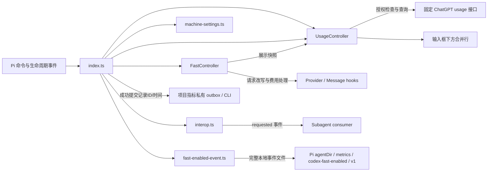
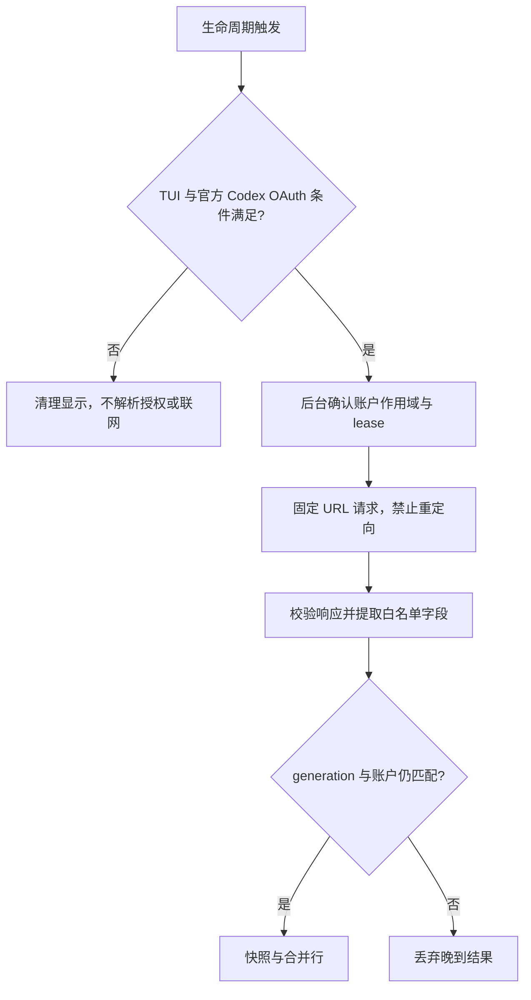
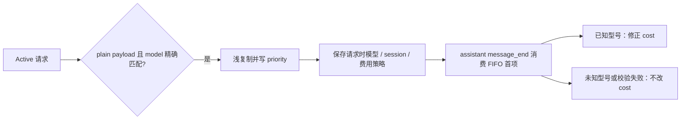

# Codex Usage Status + Fast 技术实现

这个扩展做两件事：后台读取 ChatGPT Codex 额度，在输入框下方展示；通过 `/fast` 控制符合条件的模型请求是否携带 `service_tier: "priority"`。两项能力共享一行 UI，但额度状态不控制 Fast 开关。

| 入口 | 说明 |
| --- | --- |
| 产品契约 | [Codex Usage Status + Fast 产品规范](../01-产品定义/扩展/codex-usage-status-扩展.md) |
| 源码 | [`packages/codex-usage-status/src/`](../../packages/codex-usage-status/src/) |
| 目标设计 | 已按 L1 落地：全部受控 Agent 读取同一本机开关，不新增状态扩展或共享状态 package |
| 当前源码 | 额度、priority hook、费用修正、机器偏好、本地开启事件与项目指标接缝均在 Fast 包；managed factory 支持 Runtime Worker 绑定 settingsFile/agentType |
| 验证状态 | 自动化测试、两进程偏好可见性、1.0.4/1.1.0 loopback PTY 证据已保留；并发写竞争、真实 provider 和真实 agent 目录未执行 |

## 0. 本机统一开关的目标设计

以下为待核对方案；§1–§4 描述当前源码接线，差距统一列在 §6。

### 0.1 入口与职责

| 入口 | 目标行为 | 不承担的职责 |
| --- | --- | --- |
| Fast 扩展启动 | TUI、RPC、JSON、print 及 SDK 创建的 Agent 均读取同一本机设置 | 不按角色、来源或是否有 UI 过滤；不因恢复 On 产生开启事件 |
| `/fast`、`/fast on`、`/fast off` | 无参数切换或显式设置本机开关，反馈保存结果及当前模型能否生效 | 不提供显式 toggle/status；无效参数不改变配置或计量；不自动开启异步压缩或采集 |
| 既有额度行与操作反馈 | 展示 requested 与当前请求 effective 的区别，重复 on 也给出当前型号提示 | 不增加 `/fast status` 查询入口，不因纯显示刷新调用额度 HTTP |
| 模型请求入口 | 按本机开关及实际模型资格决定 priority，保留请求时 ticket 与费用关联 | 不回溯改变已发出请求，不让旧 parent 快照覆盖本机 Off |
| 主/子 Agent 生命周期 | 只清本实例运行状态；新建、继续、重试、备用模型及 reload 均重新采用本机设置 | 不在退出时把本机偏好写 Off，不更改其他 Agent 的会话 |

### 0.2 包内配置与运行状态

- 偏好读写和刷新逻辑由 `packages/codex-usage-status/` 内部承担；不为本机布尔开关建立第三个扩展或共享状态层。
- 配置目标为本机固定 `<本机 agentDir>/settings.json` 的 `myPiExtensions.fast`，默认路径 `~/.pi/agent/settings.json`；字段只接受布尔值，缺省 Off。完整配置模板由 [L3](../03-项目落地/项目配置.md#本机功能开关)拥有。child 的 cwd、Session 目录或隔离 agentDir 不得改变这一本机来源；不继续读取候选的独立偏好 JSON。
- 只取全局值，不使用可能被项目覆盖的 merged settings；`pi.getSettings()` 或已有 SettingsManager 的内存快照本身不构成跨进程热同步。命令与手动编辑修改同一字段，普通 Agent 只有采用设置的职责，不能自行改用户开关。
- 读写均按与 Pi 宿主同一绝对路径的 proper-lockfile 协议有界协调；读取不接受原地写入的截断中间态。写入在锁内完成“锁内重读最新全局 JSON → 只改自己的字段 → 保留其他原生/自定义字段写回 → 确认结果”。命令意图去重只在当前运行作用域内存保留，显式off、外部真实布尔变化或成功会话/分支切换、reload/退出解除；首次事实写失败标不完整，不由重复on补造。请求刷新磁盘同值或无关字段变化不清除未保存意图。同实例刷新、命令和缓存更新还需有序/fence；不调用私有 SettingsManager 写方法，不把整个命名空间或旧内存快照覆盖到文件。
- 功能字段不含凭据或会话数据；整个 settings 文件仍由宿主管理，不能为两个开关重设其余配置、权限或默认模型。
- 本机持久设置是唯一启用意图源；各 Agent 只投影自己的 effective state、请求 ticket 和费用。旧 `PI_CODEX_FAST`、parent 事件及 role frontmatter 不能继续作为仅选定 child 可启用的条件，也不能覆盖本机关闭。
- 无 UI 的 Agent 自动采用设置，但普通模型执行不获得修改本机开关的权限；额度查询和 widget 仍只在原有 TUI 安全边界内运行。
- 已确认的生效边界是下一模型请求前，不等待再次输入或重启；已发出的请求保留请求时 ticket。刷新机制须覆盖手动编辑和其他进程写入；文件通知只能用作缓存失效线索，不能独自保证最新状态。读取失败/无效值时当前请求不发 priority，保存失败不冒称全机成功，正常模型工作继续；后续请求只采用重新验证的全局值。未保存命令意图只用于操作反馈和开启事实去重，不覆盖持久真值。

### 0.3 调用方覆盖

| 调用方 | 需核验的接线 |
| --- | --- |
| 普通 Pi CLI | 各模式实际加载 Fast 扩展并读取同一本机根；有 UI 只影响显示和用户控制，不影响启用 |
| Subagent dispatcher | `fast-inheritance.ts`、`runner.ts` 与 recovery seam 去除角色/来源/首次 spawn 对启用的限制；只负责正确加载和路径接线，Fast 行为仍归本扩展 |
| Workflow SDK Worker | `PiSdkWorkerExecutor` 经 `createAgentSession` 与 ResourceLoader 创建无 UI Worker；需证明也加载 Fast 并读取本机设置，不能因独立内存 SettingsManager 而遗漏或改写主会话默认模型 |
| 显式扩展 allowlist 的 child | 将所需扩展纳入经核验的加载清单；保留 `--no-extensions`、工具权限和 interceptor-last 顺序，不用放开 ambient discovery 来获得 Fast |

压缩耗时由 [Async Compaction 技术设计](async-compaction-技术设计.md)拥有；Fast 中现有通用压缩 observer 是待迁出的候选实现，不作为新增 Fast 职责。

### 0.4 原生设置机制与证据边界

已核实 Pi 1.0.4、1.1.0 的公开 SettingsManager 能保留自定义字段，原生设置保存也保留无关字段。扩展侧只读取全局来源，并使用包内 proper-lockfile 协议完成跨进程刷新和原子更新；隔离 agentDir 下的真实加载已用临时目录验证。并发写竞争和真实用户目录仍未执行。

## 1. 当前源码模块与接线

下图包含尚未完成验收、且与目标边界有差距的候选依赖，不是 §0 的目标依赖图。

| 文件 | 责任 |
| --- | --- |
| [`index.ts`](../../packages/codex-usage-status/src/index.ts) | 创建两个 Controller，注册 `/fast`、生命周期与请求/消息 hooks；导出扩展符号 |
| [`usage.ts`](../../packages/codex-usage-status/src/usage.ts) | 授权作用域、额度查询、快照有效性、唯一合并 widget |
| [`fast.ts`](../../packages/codex-usage-status/src/fast.ts) | 请求意图、模型资格判断、payload 改写、响应关联和费用修正；只提供展示快照 |
| [`interop.ts`](../../packages/codex-usage-status/src/interop.ts) | 进程内 requested 事件与 child 一次性启动参数；通过 `@pi/codex-usage-status/interop` 提供公共协议 |
| [`fast-enabled-event.ts`](../../packages/codex-usage-status/src/fast-enabled-event.ts) | 每次有效用户开启写一份独立私有的本地事件文件；不处理读取或偏好恢复 |
| [`machine-settings.ts`](../../packages/codex-usage-status/src/machine-settings.ts) | 机器 settings.json 的 Fast 字段读写、锁、路径校验与 shutdown budget |
| [`fast-enabled-event.ts`](../../packages/codex-usage-status/src/fast-enabled-event.ts) | 每次有效用户开启写一份独立私有的本地事件文件；不处理读取或偏好恢复 |

`session_start` 恢复本机偏好，`input` 和 `/fast` 命令边界刷新跨窗口提交；命令内被接受的磁盘刷新先同步真实 FastController，再基于刷新后的 requested 执行命令转换。只有用户命令导致运行 requested 实际 Off→On 才计一次开启事件，外部刷新本身不计。模型切换与 `agent_settled` 更新运行状态。`before_provider_request` 交给 Fast 改写请求，`message_end` 处理费用。`session_shutdown` 清理本实例运行状态和 UI，不把 Off 写回本机偏好，也不发布旧的 `fast-requested/v1` 会话事件。Fast 不监听通用 compaction；压缩耗时由 Async 包独立监听原生 compaction 终态。

## 2. 额度查询与展示

安全 gate 要求 provider=`openai-codex`、API=`openai-codex-responses`、base URL=`https://chatgpt.com/backend-api`，并由 Pi 确认当前模型使用 OAuth。额度查询还要求 TUI 模式。

授权来自 Pi 的 `getProviderAuth()`。Controller 在内存中解析 token 的账户作用域；无法安全解析时显示不可用。请求只发往 `https://chatgpt.com/backend-api/wham/usage`，使用 manual redirect、5 秒 HTTP timeout 和 64 KiB 响应上限。授权解析属于 Pi 操作，不受这 5 秒 HTTP 时限约束。token、账户标识和原始响应不进入 UI、日志或 session。

| 机制 | 当前行为与理由 |
| --- | --- |
| 账户有效期 | 每次确认作用域后持有 60 秒 lease；到期先清除快照，再后台校验，避免登录变化后继续展示旧账户数据 |
| 刷新与并发 | 授权和 HTTP 查询各自 single-flight，合并重复触发；普通 usage 请求最小间隔 60 秒，刷新 timer 为 5 分钟，lease 重校验可触发立即查询 |
| 晚到结果 | 模型切换、失效或关闭会推进 generation；写入前复核 generation、context 和账户，防止旧请求恢复已清除的显示 |
| 响应合同 | 只取默认 `rate_limit` 的 primary/secondary 窗口及 `allowed`；存在响应账户字段时必须匹配。`additional_rate_limits` 不进入投影 |
| 数值 | `used_percent` 必须是 `0..100` 有限值，展示 `round(100 - used_percent)`；时长和重置时间缺失时不猜测，无有效窗口按失败处理 |
| 失败与过期 | 同账户有效快照在失败后可显示 stale，但必须未满 10 分钟；满 10 分钟定时清除，无新响应也显示 unavailable。lease 到期同样会提前清除 |

`UsageController` 独占 `belowEditor` 的 `codex-usage-status` widget，格式为 `<Fast 状态> · <Codex 额度>`。它清理 `codex-usage-status` 和 `codex-fast` 两个 status key，不替换 Pi footer；隐藏、切换和 shutdown 同时清理 widget 与 status。渲染使用 ANSI-safe `truncateToWidth`，始终至多一行。

`allowed=false` 显示 `limit reached`，缺失时显示 `status unknown`；进度条表示剩余比例，不代表当前获准使用。默认 bucket 也不能证明 Spark 等专属 bucket 的可用性。具体样式和状态文案由 L1 拥有。

## 3. Fast 请求与费用

### 意图与生效条件

`requested` 是本机偏好在当前实例的投影。TUI/RPC 启动读取 `<agentDir>/extension-preferences/codex-fast.json`；缺失、无效或新实例读失败均默认 Off。有效 `/fast on|off|toggle` 更新运行意图并原子保存；保存失败时当前实例继续生效并明确提示未能确认本机保存。其他已打开实例在下一次输入或开关命令边界刷新。模型切换不清除意图；shutdown 只清运行状态，不写回 Off。headless/JSON child 不读写本机偏好，仍只接受显式一次性 child bootstrap。

| 状态 | 条件 |
| --- | --- |
| Off | requested=false |
| Active | requested=true，且模型满足资格条件 |
| Inactive | requested=true，但模型不满足资格条件 |

资格条件包括上述官方 provider/API/base URL/OAuth gate，以及精确小写 `gpt-` 前缀、非空且无空白的 suffix；`gpt-`、`GPT-*` 和非 GPT 型号不符合。`isFastEligible()` 只检查当前模型，不解析额度授权、不联网、不启动 timer。

当前源码仍接受空参数及 `on/off/toggle/status`，与 §0 仅保留空参数、on/off 的目标不符；不得把旧显式子命令当作产品支持范围。当前控制入口仍检查 `hasUI=true`，JSON/print 的偏好读取差距见 §6。命令的纯展示刷新不触发额度查询，额度 limited、stale 或 unavailable 不会自动关闭 Fast。

### 请求与响应关联

`rewriteProviderPayload()` 仅处理 plain-object 且 `payload.model === context.model.id` 的请求；返回浅复制，保留原对象和嵌套引用。其他输入返回 `undefined`。

每次成功改写都入队一个 ticket，最多 32 项，溢出丢最老项。ticket 保存请求时的模型（含 pricing）、session 身份和费用策略。响应只消费队首，再核对 provider/API/model/session；不匹配或 usage 非法时丢弃该 ticket、不改消息，也不扫描后续 ticket。shutdown 清空队列。

这样即使请求期间切换模型或关闭 Fast，费用也按请求时状态处理。未知型号同样占队列位置，避免它的响应误用后续已知型号的费用策略。

| 费用策略 | 行为 |
| --- | --- |
| `gpt-5.5` | Pi `calculateCost` 的原生费用乘 2.5 |
| `gpt-5.4`、`gpt-5.6-luna`、`gpt-5.6-sol`、`gpt-5.6-terra` | 原生费用乘 2 |
| 其他 eligible `gpt-*` | 消费 ticket，`usage.cost` 原样保留 |

目标只保留 `FAST_COST_CORRECTION_MODEL_IDS` 这一个已知计费集合公共导出，不保留 `FAST_MODEL_IDS` 别名。当前 `fast.ts` 和 `index.ts` 仍定义/导出两个名字且指向同一数组，测试也保留别名相等断言；这些是待清理的兼容代码，不是长期目标。

该集合是源码中的计费规则，不是用户本机开关配置，也不是 eligibility allowlist；删除别名不改变五个已知型号的倍率、unknown 处理或前述 Codex gate 与 `gpt-*` 形状判定。费用计算使用原生 pricing tier，将 input/output/cacheRead/cacheWrite 分量分别缩放后求和；费用已相同时不再替换。usage 的 token 计数必须为非负安全整数，reasoning 不超过 output、cacheWrite1h 不超过 cacheWrite，cost 分量必须有限；缺失或非法时不修正。合法的 error/aborted assistant message 也按已发生的 usage 处理。

未知型号激活、重复 on，以及涉及未知型号的模型切换（包括 unknown→unknown）须提示 priority 只是请求意图、费用未校正/不保证；不依赖 status 子命令。切回已知型号使用对应通知和费用策略。TUI 通知可带颜色，RPC 保持纯文本。

### 本地开启事件 producer

`index.ts` 的 `/fast` handler 将本机偏好刷新和命令转换放在同一串行队列；可接受磁盘值先同步 FastController，再捕获真实命令前状态、执行目标转换并尝试保存。机器偏好路径只在实际 Off→On 命令转换时捕获开启事实；外部刷新产生的 Off→On、重复 On、Off 方向、`status`、非法/非 UI 命令均不计。非机器偏好兼容路径仍按运行状态判断。通知在状态改变后抛错时仍尝试保存及事件记录，并保留原业务错误；本机偏好保存失败仍尝试固定警告 `Fast 仅当前实例生效；本机偏好保存无法确认。`，警告异常不替换原错误，Fast 不回滚。事件写入失败另尝试既有固定警告 `本次计量记录无法确认`。启动、child 继承、模型切换和 shutdown 不调用 producer。RPC 的 `hasUI=true` 命令与 TUI 同口径，模型 Inactive 时仍记录用户 requested 意图。

producer 用 Pi 0.84.4 公开的 `getAgentDir()`，在 `<agentDir>/metrics/codex-fast-enabled/v1/` 写入每次开启的独立 `<eventId>.json`。JSON 精确字段为 `{ "schemaVersion": 1, "eventId": "UUID", "occurredAt": "UTC ISO 8601", "source": "user_command" }`；文件名中的 UUID 与内容一致。`metrics`、`codex-fast-enabled`、`v1` 创建时均为 `0700`；已存在的自有目录必须是 `0700`，符号链接或非目录拒绝，拒绝不合规权限而不调整 Pi 根或其他目录。事件临时文件 `0600`，先完整写入并同步，再通过排他 hard link 提交到最终文件名，提交后删除临时文件；已存在的文件/链接不覆盖。只有完整合法的 `.json` 文件可按 eventId 去重计数，`.tmp`、损坏或未完成文件不计成功；当前没有读取方。此目录是本地元数据而非 outbox；不会扫描旧文件作远端回填，崩溃/断电前未完成的 I/O 不保证保存。成功提交的记录ID和时间由命令接缝交给[项目指标投递链](项目指标-技术设计.md)，仅在显式配置启用时入独立私有outbox。

记录独立于 SessionManager、assistant、授权和额度查询：无 assistant 或 `--no-session` 的正常命令写入仍留在本地；不调用 `appendEntry`，不从事件恢复 requested，也不经 Pi Session export/share。本地记录模块不读 session、凭证、prompt、账号或模型内容，不发 HTTP；投递由独立项目指标 client 读取显式私有配置执行。部署与统计验证由[项目指标实现](项目指标-技术设计.md)统一说明，不能把本地文件当成云端已接收。

## 4. 当前 Subagent 旧继承机制

以下是仍存在于源码中的旧协议，不是全部 Agent 目标的角色或来源限制。目标接线见 §0.3。

| 边界 | 当前机制 |
| --- | --- |
| Producer | 通过 `pi.events` 发布 `@pi/codex-usage-status:fast-requested/v1`，只接受精确 `{ version: 1, sessionId, requested }`，缺失、多余或非法字段忽略 |
| Consumer | [`packages/subagent/src/fast-inheritance.ts`](../../packages/subagent/src/fast-inheritance.ts) 动态加载公共 parser，按 parent session 保存意图；producer 缺失或协议不可用时安全 Off |
| 传递条件 | 首次逻辑 child spawn 时读取 parent requested；仅 resolved user-source、exact `implementer`/`code_reviewer` 且 `codexFast: inherit` 命中；project agent 和其他 user agent 不继承 |
| 启动环境 | consumer 先复制环境并删除 `PI_CODEX_FAST`，条件满足才设为精确 `"1"`；child factory 读取后立即删除，一次性使用 |
| 时间边界 | chain / 排队 parallel 各自在实际 spawn 时取快照，已启动 child 不随 parent toggle 改变；reload/new/resume/fork 的新 factory 默认 Off |

继承的是 requested 意图，不是 Active 状态。child 独立检查模型资格；parent Inactive 不妨碍符合条件的 child Active。该协议是 advisory，不是认证或安全隔离，角色与来源筛选由 Subagent consumer 拥有。

## 5. 验证入口与当前边界

| 范围 | 证据入口 / 状态 |
| --- | --- |
| Fast、FIFO、费用、通知、hooks 及开启事件命令链 | [`fast-mode.test.ts`](../../packages/codex-usage-status/test/fast-mode.test.ts) |
| 机器偏好刷新、保存、跨窗口 Off→On 计数与 headless 隔离 | [`fast-mode.test.ts`](../../packages/codex-usage-status/test/fast-mode.test.ts) |
| 通用压缩阶段耗时诊断 | [`timing.test.ts`](../../packages/async-compaction/test/timing.test.ts)；该能力由 Async package 拥有，不代表由 Fast 承担压缩展示 |
| 本地事件 schema、私有权限、排他写入、链接与非目录拒绝 | [`fast-enabled-event.test.ts`](../../packages/codex-usage-status/test/fast-enabled-event.test.ts) |
| Fast Pi 0.84.4 历史 RPC 命令与本地 Worker loopback | 历史离线验证：Off→On 有效命令得到 2 条本地记录、2 条已接收，pending=0；不是当前新版宿主兼容承诺，也不是 Cloudflare 验收 |
| 额度 DTO、授权、刷新、过期、UI 与副作用 | [`usage.test.ts`](../../packages/codex-usage-status/test/usage.test.ts) |
| 仓库内 child 继承接线 | [`fast-inheritance.test.ts`](../../packages/subagent/test/fast-inheritance.test.ts) |
| 持久化、PTY 与双进程自检 | 候选有测试和部分本地合成 provider 运行记录，但尚未按全部 Agent 目标独立验收；不将只读取共享文件或旧 profile 通过当作请求实际全机生效 |
| Pi 1.0.4 / 1.1.0 loader、ExtensionRunner、本机偏好、UI widget、请求替换、AI cost helper 与 shutdown | `pi-1.0.4-compat.test.ts` 为两版宿主建立临时安装夹具，安装 `proper-lockfile` 并连接宿主 peer；真实 loader/runner 检查 priority 请求、偏好持久化与外部刷新、退出不关闭本机开关、不发送旧 v1 事件，以及 UI 清理、组件 factory/`belowEditor`/ANSI 截断和 `calculateCost`。两版 smoke 已执行，无模型 HTTP 请求；分别以 `PI_CODING_AGENT_1_0_4_PATH` / `PI_CODING_AGENT_1_1_0_PATH` 指向对应 package 运行该测试，缺少路径时跳过。该证据不沿用旧会话级 Fast 测试结论，也不等于全部 Fast/额度/TUI/provider/child 流程兼容验收；依赖安排见 [项目配置](../03-项目落地/项目配置.md#pi-package-依赖安排) |
| Pi 1.0.4 tree cancellation | ExtensionRunner 源码确认 before-event 的 `{ cancel: true }` 会提前返回，AgentSession 只在未取消的流程后发 `session_tree`；package 的取消/退出隔离仍由 `fast-nonblocking.test.ts` 模拟接缝验证，未以真实 SessionManager 执行 tree 导航 |
| 真实交互式终端、真实账户额度请求、provider 对外请求及真实 child spawn | 未验证；兼容 smoke test 不访问凭据、不发模型请求，也不构成 TUI/provider/child E2E |
| 安装与宿主依赖 | [项目配置](../03-项目落地/项目配置.md#pi-package-依赖安排)，以 manifest/lockfile 为准 |

扩展只保证自身 hook 的输出。Pi 0.84.4 与 1.0.4 均没有最终 provider payload 或最终持久化 message 的可观测 hook；1.0.4 增加的 `before_provider_headers` 只允许修改请求头，不能证明最终请求 payload。后续请求 handler 可能改写 priority，其他消息 handler 可能改写 model/session、usage token 或 cost。因此支持费用关联与持久化结果的组合要求这些输入和结果不被其他 handler 改变；不能从 Active 推断 provider 接受 priority、实际加速或最终费用。

额度失败不阻塞、取消或改变模型请求；本扩展不自动重试/fallback 模型请求。授权和 usage 接口是外部依赖，不能可靠读取时显示不可用，不估算额度。

自动化入口为根目录 `npm run test:agent` 与 `npm run typecheck`。已有固定 revision 的[验证记录](../归档/评审/codex-usage-status-fast-gpt-v1-交付记录.md)不替代目标设计的新验收。

## 6. 当前差距与未决项

| 能力 | 当前事实 | 未覆盖项 |
| --- | --- | --- |
| 本机 Fast 偏好 | `machine-settings.ts` 读写 `settings.json.myPiExtensions.fast`，命令只接受空参数/on/off，跨进程锁内刷新 | 并发写竞争、真实用户 agentDir |
| 全部受控 Agent | 默认 CLI 与 Runtime managed factory 传递同一 settingsFile；旧 dispatcher/legacy loader 不自动宣称已绑定 | subagent 真实 dispatcher 联跑、缺包/peer 冲突现场 |
| 压缩耗时 | Async 独立拥有 observer、duration schema 与本地展示；Fast 不重复注册 | 真实 provider 性能与远端采集 |
| 版本基线 | Fast/Async peer 为 `>=1.0.4 <1.2.0`，开发与 Runtime SDK 为 1.1.0 | 真实全局安装不改动，未覆盖真实凭据 |
| Fast 生效边界 | priority hook 按刷新后的请求时设置，legacy `PI_CODEX_FAST` 不初始化偏好 | provider 最终采用 priority 与实际加速效果仍由宿主/provider 决定 |

## 7. 验证矩阵与剩余验证

- 已执行：`npm run test:agent`（候选快照曾为 977 passed）；`npm run typecheck`；lockfile 安装、链接检查与 diff check；临时 HOME/agentDir 的 Fast/Async PTY、1.0.4/1.1.0 loopback provider、双进程设置可见性。
- 未执行：多进程同时写入的压力竞争、真实 provider/凭据、真实用户 agentDir 与 Cloudflare 部署。
- 仅空参数、on/off 是有效用户命令；显式 toggle/status、多参数和未知参数不改变本机或运行意图、不写偏好、不计量。用户一次 Off→On 仅产生一条开启事实；多个 Agent 的恢复和自动同步均为零新增事实。无 UI 开启 Fast 不触发 TUI 额度查询或伪造通知。
- 保留 FIFO、模型资格、known/unknown cost、在途响应与 shutdown 关联回归；不把 hook 输出当作 provider 已接受或实际加速的证明。
- 验证启动器显式加载及 SDK ResourceLoader，保持 tools/skills 和 side-effect fence 边界。源码、独立评审与适用运行验收齐全前，§0 仍为方案而非已具备能力。
