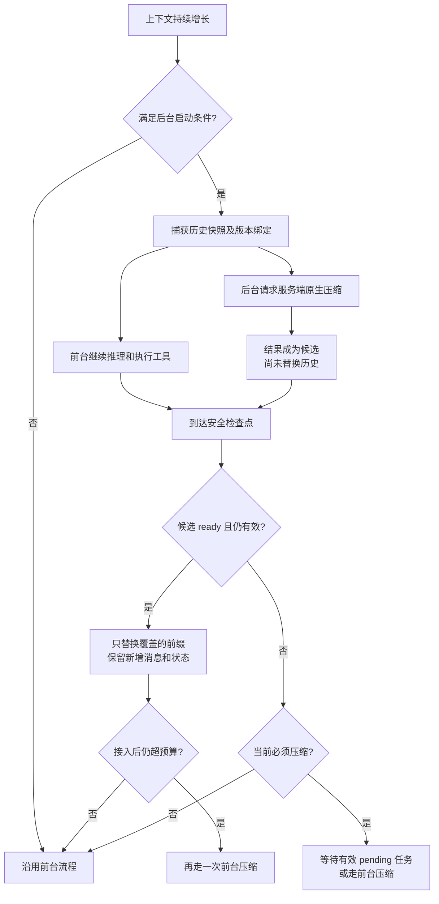
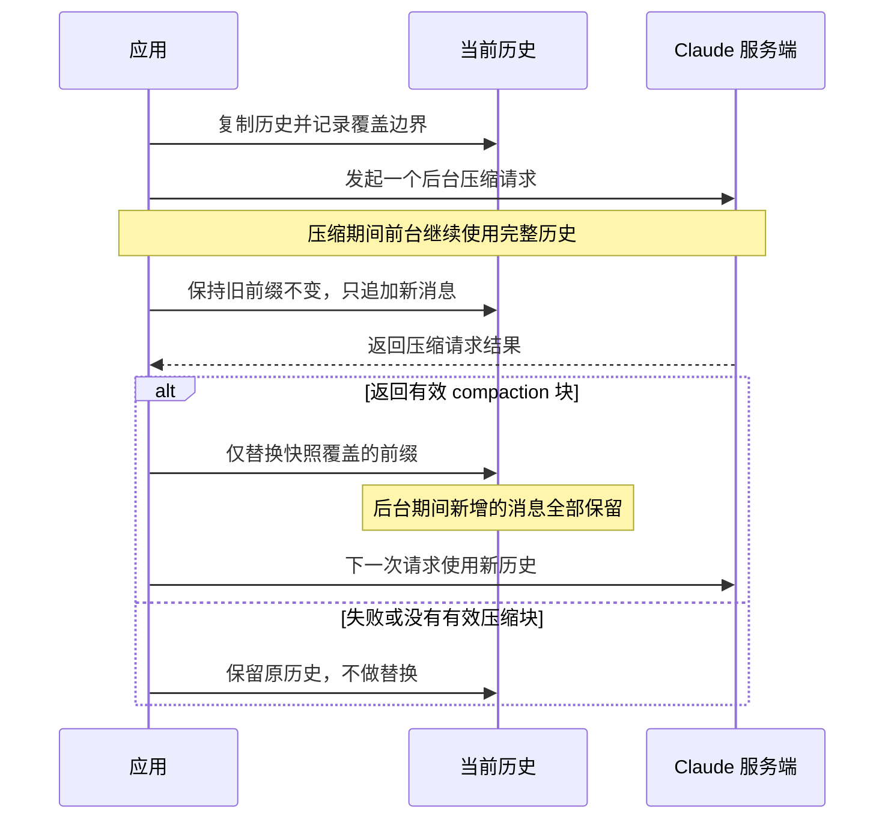
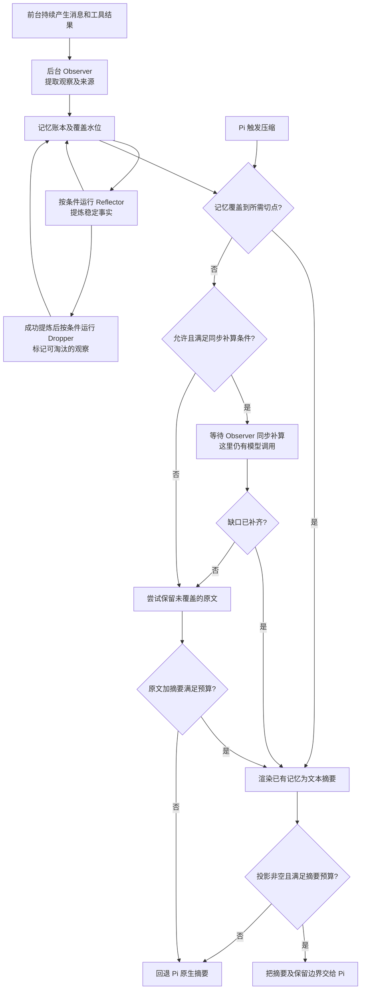
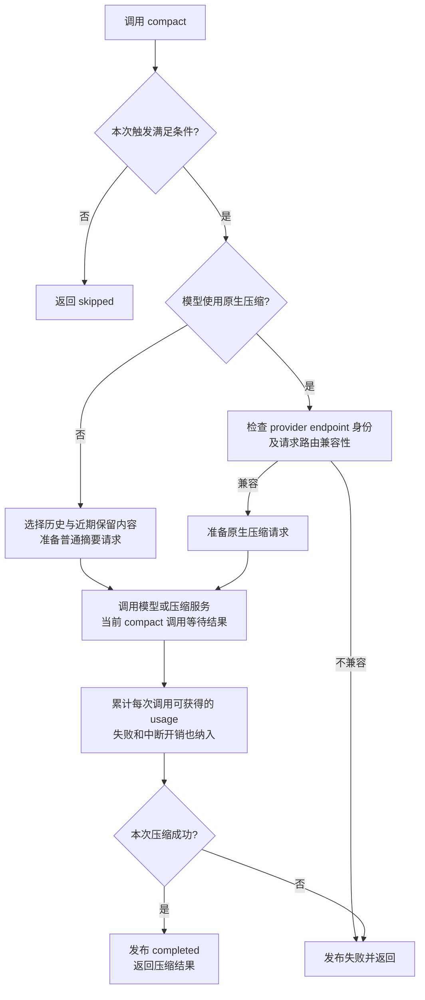

# 异步上下文压缩：实现调研

**结论：异步压缩主要减少前台等待，不保证减少摘要生成时间或费用。** 可借鉴的共同机制是：提前截取稳定历史前缀，在后台生成压缩结果，保留期间新增的上下文，在宿主安全边界校验后接入；准备不足时仍需要同步兜底。

- 资料核验日期：2026-10-17；这是研究证据，不是已采纳契约。
- 仓库基线：`4e40626`。没有新增实现、安装扩展、修改 Pi 配置或调用模型做性能实验。
- 产品讨论入口为 [L1 对齐稿](../../01-产品定义/扩展/async-compaction-扩展.md)，实现状态由 [L2 技术说明](../../02-产品实现/async-compaction-技术设计.md)拥有；[研究阶段方案比较](../评审/2026-10-17-异步压缩-需求与方案对齐.md)仅保留备选与风险。

## 1. 先分清在优化什么

| 做法 | 是否允许前台推理继续 | 主要收益与限制 |
| --- | --- | --- |
| 更早触发同步压缩 | 不一定 | 降低溢出风险，但等待仍在关键路径上 |
| 后台预计算摘要 | 是，直到必须压缩 | 把耗时移出关键路径；需要快照、覆盖边界和过期校验 |
| 服务端原生压缩 | 不一定 | 服务端返回原生压缩块；是否后台运行由客户端调度决定 |
| 持续观察/记忆提取 | 是 | 平摊生成成本，但引入记忆账本、覆盖进度和更多模型调用 |
| 工具输出裁剪/历史召回 | 通常是本地处理 | 可减少输入体积；不是“后台生成摘要”的同义词 |

把一个函数标记为 `async`，或不等待 `ctx.compact()` 的返回，不等于用户可以继续正常推理。以下流程图是固定资料范围内的机制示意，不是性能测试或已在本仓库实现的证明。

## 2. Codex：已合并的真实后台压缩

### 证据与状态

- [#53614：后台 remote V2 压缩基础设施](https://github.com/openai/codex/pull/53614)，2026-10-13 合并；该 PR 自身明确说明当时尚未接入 turn loop。
- [#53800：接入 turn lifecycle](https://github.com/openai/codex/pull/53800)，2026-10-13 合并；接入 pre-turn、mid-turn、post-turn 检查点。
- 本文源码固定于 `e16b631d08cdf82773831f9bbfb793da687d5299`，不把搜索摘要、旧 Issue 或 PR 标题当作运行合同。
- [feature 定义](https://github.com/openai/codex/blob/e16b631d08cdf82773831f9bbfb793da687d5299/codex-rs/features/src/lib.rs)：`async_compaction` 为 `UnderDevelopment`，默认关闭。已合并不代表默认启用或所有 provider 都可用。

### 执行机制

前台与后台从快照处分开；只有检查点校验通过，候选才成为实际上下文。图中未展开的 feature、模型、认证和取消条件如下。

1. [启动条件与任务状态](https://github.com/openai/codex/blob/e16b631d08cdf82773831f9bbfb793da687d5299/codex-rs/core/src/session/async_compaction.rs)：要求 feature 开启、provider 支持 remote compaction V2，且没有启用 TokenBudget 路径；前台已到硬限制时不再新开推测任务。pre-turn 还会等待前台建立后端 model pin。
2. [配置 schema](https://github.com/openai/codex/blob/e16b631d08cdf82773831f9bbfb793da687d5299/codex-rs/core/config.schema.json)：后台阈值默认 65，范围 1–100，表示完整 context window 的百分比；**只设阈值不会开启功能**。它不是 Pi 的默认值，也不是通用最优值。
3. 捕获历史、prompt metadata、路由状态、认证归属代际、context window 和 world state。后台请求与前台路由隔离；基础设施 PR 明确使用 HTTP 发送后台请求。
4. 通过 history version、model slug、compaction hash、auth owner generation 去重；只保留最新候选接收通道。不能把这个实现描述成“代码保证只有一个后台网络任务”：源码还有独立 TaskTracker 管理已启动任务。
5. [turn loop](https://github.com/openai/codex/blob/e16b631d08cdf82773831f9bbfb793da687d5299/codex-rs/core/src/session/turn.rs) 在检查点尝试取出完成结果；真正必须压缩时可以等待仍有效的 pending 任务。
6. [结果安装](https://github.com/openai/codex/blob/e16b631d08cdf82773831f9bbfb793da687d5299/codex-rs/core/src/compact_remote_v2_installation.rs) 检查型号/兼容 hash，并交由历史替换原语校验 prefix；只替换快照覆盖的部分，保留 live suffix 和后续 world-state 更新。可选候选被拒绝时允许继续工作。
7. 接入候选后若仍超预算，走一次前台压缩兜底，不能假设“有摘要就一定够用”。
8. 用户停止当前 turn 后不再启动新任务，但已有任务属于 session，可留给后续使用；session shutdown 则取消并等待清理。已完成但未采用的请求仍计 usage。

### 能借鉴和不能照搬的部分

可借鉴的是“提前计算 + 精确前缀替换 + 增量保留 + 安全检查点 + 硬限制兜底”，不是单独一个配置开关。remote V2、后端 model pin、认证 ownership 和原生压缩块依赖 Codex 自己的 runtime/provider 协议，不能直接塞入 Pi 的纯文本 summary 字段。

旧 [#18007](https://github.com/openai/codex/issues/18007) 是需求提案，页面显示 closed as not planned；它的状态不能替代上述新 PR 与源码事实。

## 3. Claude API：官方文档明确给出了后台算法

这里是应用管理一个 pending 请求及覆盖边界；不是服务端自动替应用维护可变历史。[Compaction in the background](https://platform.claude.com/docs/en/build-with-claude/compaction-background) 描述：

1. 复制当前历史，并记下本次发送覆盖的消息范围。
2. 旧前缀保持不可修改，前台继续使用完整历史，新 turn 只追加。
3. 同时只挂一个 pending compaction；完成且 `stop_reason == "compaction"` 才可替换。
4. 用返回块替换当时发送的前缀，保留之后追加的消息；下一次请求使用新上下文。
5. 没有返回有效块时保留原历史。后台请求同样占用 rate limit；必须留足期间增长空间。

[Compaction overview](https://platform.claude.com/docs/en/build-with-claude/compaction) 区分 on-demand、threshold 和自定义 summarizer；threshold 压缩是在请求里运行，不能自动等同于后台压缩。

[Preserved thinking 约束](https://platform.claude.com/docs/en/build-with-claude/compaction-thinking-blocks) 还要求保留 turn 与原前缀连续、内容不变，并满足模型、system/tools 兼容条件。自行生成普通文本摘要不等于获得服务端压缩块的 thinking 兼容保证。

这是 **Claude API 能力和官方应用算法**的证据，不足以宣称 Claude Code CLI 在所有版本中使用相同实现。

## 4. Pi 生态：持续记忆与历史实验

### pi-observational-memory

固定 revision：`022da5e5554d04dfdc876ed7dac4a42c6b83dfd4`。

它在平时持续记笔记，而不是只提前生成一次完整压缩包。覆盖水位表示“记到了哪里”：没有覆盖的原文必须保留、补算或交给原生摘要，不能直接删除。

- [运行说明](https://github.com/elpapi42/pi-observational-memory/blob/022da5e5554d04dfdc876ed7dac4a42c6b83dfd4/docs/how-it-works.md)：在 `turn_end` 后台提取 observation，再按进度提炼 reflection；账本以 `coversUpToId` 跟踪覆盖水位。
- 压缩时由 [compaction hook](https://github.com/elpapi42/pi-observational-memory/blob/022da5e5554d04dfdc876ed7dac4a42c6b83dfd4/src/hooks/compaction-hook.ts) 把已准备的记忆渲染为 summary。
- observer 落后时，源码会保留尚未覆盖的原文，或委托 Pi 原生摘要；不能把“未观察”当作“可以丢弃”。保留后的 tail 加 summary 仍需满足预算，overflow 场景更保守。
- **存在文档/源码差异**：运行说明称 compaction hook 不调用模型、不等后台任务；但该 revision 的源码会 `await catchUpObserver(...)`，[配置默认](https://github.com/elpapi42/pi-observational-memory/blob/022da5e5554d04dfdc876ed7dac4a42c6b83dfd4/src/config.ts) `compactionCatchUpMaxChunks = 2`。因此不能笼统承诺“所有压缩均零模型、立即完成”。

它证明 Pi 扩展可以提前做记忆工作，但不是无需评估即可安装的透明替代品。observer/reflector/dropper 的质量、费用、覆盖水位和账本恢复是额外设计面；本文没有安装或实测它。

### Pi 历史 PR #160

[instant auto compaction](https://github.com/earendil-works/pi/pull/160) 曾尝试 turn 后预生成缓存，压缩时命中即复用。PR **已关闭、未合并**。

维护者在评审中指出：后续历史增长会让缓存 cut point 落后于真实需要，可能仍不得不重新生成；预计算也可能浪费付费额度并显著增加核心复杂度。作者给出的约 24 秒到 1 秒是该实验的自述，不是我们的可复现实测。

这意味着“缓存有效”不能只看文件存在或 session ID 相同；必须同时检查覆盖范围、当前 tail 大小和实际回收收益。

## 5. OpenCode：作为同步压缩对照

固定 revision：`65932e870ca50d21886f9d0ee89c6603bac34a65`，来自 `dev`，不能直接等同于某个正式发布版本。

图中没有“先返回候选、前台继续、以后再安装”的并行分支。[SessionCompaction 实现](https://github.com/anomalyco/opencode/blob/65932e870ca50d21886f9d0ee89c6603bac34a65/packages/core/src/session/compaction.ts) 同时支持普通摘要与 provider native compaction；其 `compact()` effect 等待生成，再发布 completed/failed。这里的“同步对照”指调用链等待本次压缩完成，不是说它使用阻塞线程或同步 HTTP。

值得借鉴的是：usage 按模型调用记录，而不是只给最终采用的摘要计费；原生压缩结果绑定 provider endpoint provenance，不能跨不兼容端点复用。

**核查边界**：单凭这个模块没有发现“后台候选生成、前台继续、稍后接入”的完整状态机，不能因为它使用异步 effect 就标成异步压缩。本文没有对整个 OpenCode runtime 做穷尽审计，也不据此断言整个产品没有任何后台压缩能力。

## 6. 本机 Pi 当前事实

### 版本不是一个统一基线

| 位置 | 只读核实到的版本 | 说明 |
| --- | --- | --- |
| 本机全局安装包 | `@earendil-works/pi-coding-agent` 1.0.4 | 本文主要本地源码/文档证据；不据此证明所有正在运行的进程均为该版本 |
| 仓库根 `node_modules` | 0.84.4 | 与新版全局 API 不可混用 |
| 仓库 Subagent manifest/lockfile | 1.1.0；peer 范围 `>=1.1.0 <1.2.0` | 已有严格 wire/session 协议检查 |
| 用户自己的未跟踪 `pi/` clone | package 0.99.1，HEAD `295cc72` | 只核实版本，不修改、不作为当前宿主基线 |

上游对照固定在 [v1.0.4](https://github.com/earendil-works/pi/tree/7c10bd4337495ee613f2224843ecdf349b80d1df) 与 [v1.1.0](https://github.com/earendil-works/pi/tree/abe508e1b89912adde45528136c3221eb69acdd7)。实现前必须明确目标宿主，不能顺手升级用户配置或声称兼容所有版本。

### 原生路径为何有可见等待

依据全局包完整阅读的 `docs/compaction.md`、`extensions.md`、`sdk.md`、`session-format.md`、`settings.md`、`sessions.md` 及相应 `dist/core` 实现：

- 默认阈值为 `contextTokens > contextWindow - reserveTokens`；默认 reserve 为 16384，保留最近约 20000 tokens。阈值预算还影响摘要输出上限，不只是触发时机。
- [AgentSession](https://github.com/earendil-works/pi/blob/7c10bd4337495ee613f2224843ecdf349b80d1df/packages/coding-agent/src/core/agent-session.ts) 的自动压缩路径等待 `session_before_compact` 和摘要生成，完成后才继续；手动 `compact()` 先 `await abort()`。
- [摘要生成](https://github.com/earendil-works/pi/blob/7c10bd4337495ee613f2224843ecdf349b80d1df/packages/coding-agent/src/core/compaction/compaction.ts) 沿用解析后的摘要模型和 thinking；split-turn 下历史摘要和 turn-prefix 摘要可以先后各有一次模型调用。网络、推理和 retry 都可能增加等待。
- 这些是“可能的耗时来源”，不是用户当前慢压缩的已证实根因。尚无本机完整耗时分段、P50/P95 或 provider 性能样本。

### 扩展可以做什么，不能假定什么

| 接缝 | 已核实事实 | 对方案的影响 |
| --- | --- | --- |
| `session_before_compact` | 可返回 summary、`firstKeptEntryId`、usage、details；宿主等待 hook，并由宿主追加 compaction | 适合交付提前准备好的摘要，沿用原生生命周期 |
| `ctx.compact()` | API 返回 void、调用方不等待；底层仍进入手动压缩流程 | 不等于不中断当前工作，不能在活跃 turn 随意调用 |
| `turn_end` / `agent_before_settle` 的 compaction draft | 1.0.4 本地类型与 1.1.0 上游类型均支持，宿主提交后重建上下文 | 可研究主动接入候选，但需要独立验证队列、恢复和其他扩展的相邻合同 |
| boundary draft 生命周期 | 1.1.0 的 `_commitBoundaryDrafts()` 发 `entry_appended`，并非原生压缩路径的整套 `session_compact` / `compaction_start/end` | 不能假装两条路径对监听者完全等价 |
| `SessionManager` | 扩展 context 提供只读接口；SDK 文档明确 finalized context 以 manager 为权威 | 不直接赋值 agent messages，也不自己重写活跃 JSONL |
| 丢弃候选的 usage | 原生 CompactionEntry 可携带已采用摘要的 usage；已查的 boundary draft 没有通用 usage entry draft | 不能假定所有后台开销自动进入原生会话总账；需设计不漏计且不重复计的方案 |

独立“上下文压缩”的产品讨论由 L1 对齐稿拥有，当前仍未采纳；未实现项在对应 L2 集中记录。Codex Usage/Fast、通用 Subagent 和 Workflow 的运行状态不拥有全局 Pi 会话压缩。

## 7. 调研边界

已完成：官方 PR 与固定 revision 源码核对、本机 API/版本检查、扩展方案可行性和风险识别。

未完成：本机耗时诊断、真实 provider 并发/限流测试、任何候选扩展的安装验证、摘要质量实验、独立产品语义及实现/运营评审。因此本文没有速度提升承诺，也不构成实现或启用授权。
