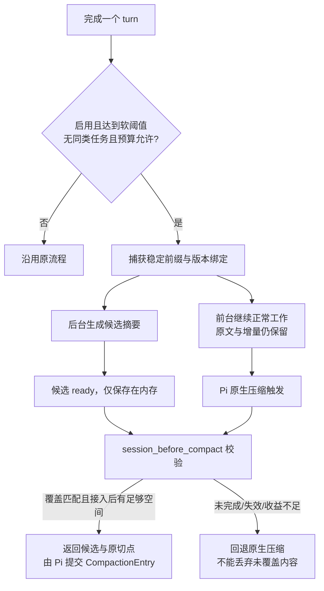

# Pi 异步压缩：需求与方案对齐稿

**建议先验证“后台预生成摘要、原生压缩时快速接入”，不要一开始 fork Pi 或引入完整记忆系统。** 目标是减少压缩打断工作的时间，不承诺模型生成更快，也不牺牲期间新增消息、工具结果和会话恢复。

本文保留研究阶段的方案比较和待讨论建议，未采纳、未独立评审，不是 L1/L2 正式真理源。产品讨论统一在 [L1 对齐稿](../../01-产品定义/扩展/async-compaction-扩展.md)继续，当前事实与未实现项由 [L2 技术说明](../../02-产品实现/async-compaction-技术设计.md)拥有；下文对 A/B 路线的建议不能被视为产品已选择的方案。事实依据及固定源码链接见 [调研报告](../研究/2026-10-17-异步上下文压缩调研.md)。

## 1. 要解决的用户问题

已确认的输入：用户感觉 Pi 的上下文压缩等待很长，希望参考 Codex 的异步压缩，在不中断工作的情况下提前处理上下文。

尚未确认：主要耗时来自模型输入、thinking、摘要输出、重试、扩展 hook 还是上下文重建；尚未确定实际宿主版本、可接受额外费用、使用范围和跨 provider 要求。

建议区分两个目标：

| 目标 | 候选保证 | 不应混淆的事实 |
| --- | --- | --- |
| 减少阻塞 | 摘要能提前生成；命中时不在前台重新调用摘要模型 | 没命中、过期或超预算时，仍可能同步等待 |
| 保持连续性 | 后台期间可按 Pi 原有规则继续模型/工具执行、提交 steering/follow-up | 不代表同时运行两个前台 agent，也不代表排队输入已经被模型消费 |

不以“更高压缩率”作为第一目标。过度压缩或保留错误状态，会让任务返工，抵消节省的等待。

## 2. 方案选择

| 选项 | 机制 | 优势 | 风险与边界 |
| --- | --- | --- | --- |
| A：预生成摘要 + 原生接入 | 后台生成稳定前缀的摘要；在 `session_before_compact` 交给 Pi | 扩展即可研究实现，沿用原生提交、事件与恢复路径 | 接入仍等到原生触发；旧切点 tail 可能过大，必须检查收益并回退 |
| B：安全边界主动接入 | 结果 ready 后，在 `turn_end` / `agent_before_settle` 返回 compaction draft | 不必等到接近硬限制，可尽早释放上下文 | draft 与原生压缩生命周期不完全等价；前置/队列/overflow 边界、usage 和消费者兼容需要补齐 |
| C：修改 Pi 核心 | 类似 Codex，在 turn 调度里管理候选、等待和安装 | 宿主能统一处理模型、队列、事件和 usage | 上游维护或 fork 成本较高，不是本仓库一个普通扩展开关 |
| D：安装持续记忆扩展 | observation/reflection 等后台维护压缩材料 | 可摊平长会话工作，并提供原文召回 | 引入不同记忆语义与账本、更多模型调用；现有项目也有同步 catch-up 情况 |

**建议以 A 为首个验证范围，B 作为独立备选，不把 A 宣称为“所有时刻零等待”。** 先测命中比例、实际阻塞和额外开销；如果 A 因切点落后频繁失效，再用数据决定 B/C，而不是预设完整后台记忆架构。

普通文本摘要与 OpenAI/Claude 的服务端原生压缩块是不同产物。第一版建议保持 Pi 的文本 summary 合同；不把 encrypted/native block 塞进 summary，也不扩大 provider 权限或绕过既有认证。

## 3. 建议的产品边界

以下均为候选规则，需确认及评审后才生效：

- 独立、显式 opt-in，不默认加载到所有主会话或 Subagent child。默认不改变 `/compact`、自动压缩和 overflow 恢复的产品语义。
- 后台失败不能使原上下文失效；原始会话历史仍由 Pi 保存，不删除、重写或重放实际工具操作。
- 每个 session 至多一个本扩展后台任务；按有效上下文代际去重，有最小增长间隔、冷却和预算，避免每个 turn 全量重算。
- 只压缩已完成、可稳定引用的前缀。保留最近原文以及后台期间的完整增量，不能让一条摘要代替尚未完成的工具调用。
- 用户可查看“后台准备中 / 已准备 / 已失效 / 正在同步兜底 / 已关闭”，而不是只看到一个无法判断的 spinner。
- 没有合格候选时走原生压缩；不能为了表现“无等待”而跳过硬限制、悄悄截断上下文或吞掉压缩错误。
- 摘要模型默认不跨 provider 发数据。是否允许指定更快型号、降低 thinking，需要显式选择；更换模型是另一条优化轴，不和异步收益混算。
- 不读取/输出凭证，不新增远端 telemetry。摘要和候选含敏感会话内容；第一版建议仅内存缓存，退出后丢弃未采用候选。

## 4. 选项 A 的机制草案

### 捕获的绑定事实

候选至少绑定 session identity、extension generation、活动分支上的 prefix 边界、前一次 compaction identity、来源投影指纹、`firstKeptEntryId`、摘要模型/provider/endpoint identity、相关 system/tools/config revision，以及生成状态和 usage。

这里的“快照”不是直接持有可变消息数组。准备阶段应复制必要 plain data；后台任务只计算结果，不在完成回调中直接修改活跃会话。

不因为 leaf 新增而机械判定失效：正常追加正是异步压缩要允许的行为。需要检查原前缀仍是当前分支的同一有效前缀；分支离开、prefix 替换或 `context_edit` 影响候选输入时，不再复用。第一版可以采取更保守的失效策略。

### 安全接入

1. `session_before_compact` 使用当前 canonical projection 复核候选，不把“同 session”或“已有缓存”当作充分条件。
2. 沿用候选自己的 `firstKeptEntryId`，使旧切点之后的原文和所有新增消息仍保留。不能用旧摘要配上当前更靠后的切点，否则中间区间会丢失。
3. 验证 tool call/result 配对，禁止切在孤立 tool result 上；split-turn、已有 summary、system checkpoint 和 context edits 都需用宿主语义解释。
4. 估算 **当前 system/tools + 候选摘要 + 全部 retained tail + 待发送输入 + 输出预留**。不仅要“不超窗”，还要有可观测回收收益和防止立即再次压缩的余量；否则回退。
5. 返回摘要供宿主追加并重建上下文；不直接赋值 `agent.state.messages`、不写活跃 JSONL、不调用私有 SessionManager 写接口。
6. 手动 `/compact` 带新 instructions 时，除非候选确实绑定同样指令，否则绕过候选。overflow 候选也必须单独验证足以释放空间，不能仅因已有摘要就使用。
7. 保留 Pi 原有队列与恢复控制；“保留/重新投影消息”不是重新执行已发生的 bash/edit 或重新提交工具结果。

候选未完成时是“短暂等待复用”还是“立即取消并同步兜底”仍需决策。建议先给等待设严格上限，并确保不会无界等待或启动两个竞争的摘要；上限数值不在本稿中采纳。

### 失效、取消与恢复

| 情况 | 候选处理与前台语义 |
| --- | --- |
| 正常新增消息/工具结果 | 前缀有效时可继续用候选，新增部分原样保留；接入时重算预算 |
| `/tree`、fork/new/switch、重做已有上下文、原生或其他扩展已压缩 | 校验失败就废弃；不把结果接入其他 branch/session |
| 换模型、provider/endpoint、system/tools 或相关设置变化 | 第一版保守失效；不能跨不兼容协议复用 |
| reload/shutdown | 取消本代任务；旧 callback 不得写入新 runtime。已完成 usage 仍需记录 |
| 用户停止当前运行 | 需要明确“只停止前台”还是“一并取消后台”；在确认前不得暗示 Esc 一定停止所有请求 |
| timeout、限流、空摘要、截断摘要、provider 错误 | 不接入；维持原历史，受控回退与冷却；错误只显示安全分类 |
| 进程崩溃 | 未采用候选丢弃；已提交摘要按 Pi 原有 JSONL 恢复，不另造 session 状态真理源 |

状态候选：`idle → generating → ready → adopted`；并列终态为 `failed / cancelled / discarded`。ready 不等于已释放上下文，adopted 才表示宿主接入成功。

## 5. 阈值、并发与费用

软阈值需要给后台生成留下增长空间，硬限制继续由 Pi 控制。不能直接把 Codex 的 65% 写成仓库默认。

可用的估计模型：`所需余量 ≥ 上下文增长速率 × 摘要耗时P95 + 下一批输入/工具结果预算 + 安全裕量`。这只是调参依据；实际接入仍需基于当前投影校验，不能把平均增长当作保证。

需要记录已采用、已丢弃、失败和取消请求的已知 usage，并区分 provider 未返回 usage 的 unknown。已采用摘要写入原生 CompactionEntry 时不能再重复计一遍；原生会话总账未包含的后台 usage 也不能伪装为零。

本机 API 检查尚未证明纯扩展可以把所有丢弃 usage 写入原生总账。可选择明确标注的扩展侧账本或补宿主 usage 接缝，但这是待评审缺口，不是已解决细节。

## 6. 验收与实验建议

### 先建立可比较基线

用可公开的合成对话/工具结果，在固定 Pi 版本、provider、模型、thinking 和摘要配置下比较原生模式与候选模式。覆盖短回合、长工具链、巨大工具结果、慢 provider、限流、连续补充输入和多次 compaction。

只有真实 provider + Pi TUI，以及目标 JSON/RPC 模式的证据才能证明交互体验；纯 mock 测试不能证明真实压缩耗时或并发不受限。

### 指标口径（待实现，不是已有 telemetry）

| 指标 | 口径 |
| --- | --- |
| 可见压缩阻塞 P50/P95 | 同一类真实压缩检查点，从阻止下一次正常模型请求到允许继续的时间；包含 miss、失效和 fallback，不能只统计 cache hit |
| 摘要生成耗时 P50/P95 | 每个后台尝试从开始请求到生成终态，按成功、失败、取消区分 |
| 快速接入率 | 成功采用 ready 候选的原生压缩次数 / 启用范围内全部原生压缩次数；以唯一 attempt/adoption identity 去重 |
| 浪费比例 | 最终未采用后台调用的已知 totalTokens / 全部后台调用的已知 totalTokens；同一归一化口径下计算，unknown 单独计数，不冒充完整成本 |
| 总开销 | 同等任务的总 tokens、费用与任务耗时，包含失败、取消及丢弃，不只看每次摘要价格 |
| 连续性质量 | 合成固定事实、约束、最新补充、工具结果和未完成事项在压缩后可正确恢复；分开统计遗漏、重复和错误状态 |

命中时“接入无需新的摘要请求”可以做确定性验收；“P95 阻塞低于 1 秒”可作为待验证目标，但不是当前性能承诺。是否启用还需同时看全量阻塞改善、额外费用和任务质量，不能只看单次命中演示。

### 必须覆盖的正确性场景

- 生成期间连续追加 user/assistant/toolResult，接入后无遗漏、无乱序，也没有重复执行外部副作用。
- tool 并发、split-turn、连续两次压缩、旧摘要、context edit、system/tools 变更。
- ready 与 fork/tree/switch/reload/shutdown/另一次压缩竞态，旧代结果不能迟到写入。
- 大量 delta 导致候选仍超预算、没有足够回收收益，以及 overflow 期间候选未完成。
- 原生 retry、steering/follow-up、用户取消、自定义 `/compact` instructions 和其他 compaction extension 同时存在。
- provider 失败/429/timeout/截断/空摘要，冷却、并发上限及 usage 漏计/重复计。
- 真实宿主与本仓库 Subagent 严格 wire/session 校验兼容；未支持的旧宿主明确拒绝启用或保留原生路径。

## 7. 正式 owner 与已知缺口

本功能不是 Codex Usage/Fast，也不是 Workflow 的状态控制；目前未找到已有 owner。

若明确采纳独立 Extension，建议 L1 owner 为 `docs/01-产品定义/扩展/async-compaction-扩展.md`，L2 owner 为 `docs/02-产品实现/async-compaction-技术设计.md`。这里只标明候选位置，不提前创建正式产品契约或 package；package、依赖范围和安装默认只有采纳后再写回 L3。

| 当前事实 | 目标设计 | 已知缺口 |
| --- | --- | --- |
| Pi 原生压缩等待摘要调用 | 在后台提前完成可复用摘要 | 没有本仓库实现，也没有用户耗时分段 |
| 新版有 hook 和 boundary draft | 优先原生 hook 接入 | 多扩展组合、稳定快照和 cut point 校验尚未实测 |
| draft 不等价原生完整事件链 | B 如被选择需可靠生命周期 | 不得伪造 native compaction events，消费者兼容未验证 |
| 本地全局/根依赖/Subagent 版本不一致 | 明确且测试一个目标宿主范围 | 尚未决定兼容基线，不升级任何现有依赖 |
| 后台调用会花费 tokens/额度 | 不漏计已丢弃开销，有预算与关闭机制 | usage 接缝和预算默认待决策 |

在进入实现前，必须保留两条独立评审原文：产品语义/指标轴与实现/运营轴；评审者只报告 finding，不修改方案。用户决策、未解决分歧及 P0/P1 必须显式保留。本稿尚未经过这两条评审，不可视为实施批准。未来 coding 仍须走 implementer → code_reviewer 及仓库验证门禁。

## 8. 请用户确认的五个决定

1. **优先目标**：先减少压缩阻塞，接受有限额外调用，而不是要求总 tokens/费用也同时下降？建议如此，但需要预算上限。
2. **首个范围**：先用 A（独立扩展、原生接入）验证，还是直接要求 B/C 的“ready 即在安全点主动切换”？建议 A。
3. **适用范围**：先只覆盖主会话，明确宿主版本，不自动给 Subagent child 启用？建议如此。
4. **摘要模型**：先保持当前 provider/模型以隔离异步收益，还是允许显式指定更快型号和更低 thinking？建议先保持 provider，型号策略单独确认。
5. **取消和成本**：用户停止时是否同时取消后台；允许多少额外请求/费用、接入时最多等多久？这些数值与行为需明确，不能照抄其他产品默认。
